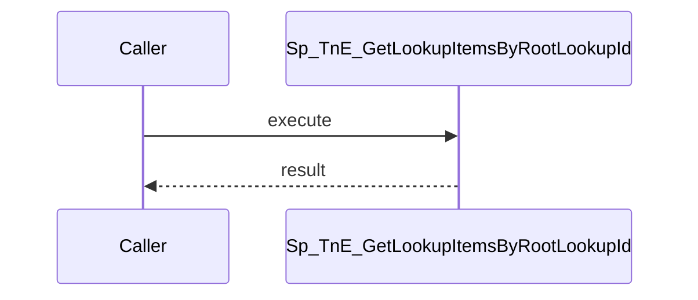
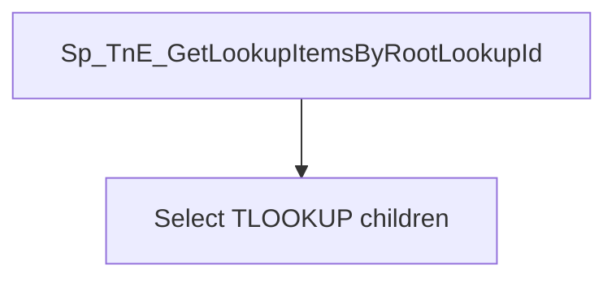

# Sp_TnE_GetLookupItemsByRootLookupId

## What it does

Returns lookup children under a root lookup id for one employer. For expense status root `1000`, remaps **Pending with Accounts** parent id to `0` so the Report UI can treat it as a root status.

## Parameters

| Name | Direction | What it is for |
|---|---|---|
| `@pRootLookUpId` | in | Parent lookup id (Report uses `1000`) |
| `@pEmployerid` | in | Employer scope |

## Call sequence

## Callers

| Caller | Page |
|---|---|
| `ReportsDAL.GetLookupItemsByRootId` | [Report](/docs/guides/expense-and-reimbursement/report) |

## Nested

Calls no other procedures or functions.

## Steps

1. Select from `TLOOKUP` where `LOOKUP_PARENT_ID = @pRootLookUpId` and employer matches.
2. Special-case Pending with Accounts parent when root is `1000`.

## Tables

| Table | Read or write |
|---|---|
| `TLOOKUP` | read |

## Unresolved calls

None.

## Flow

