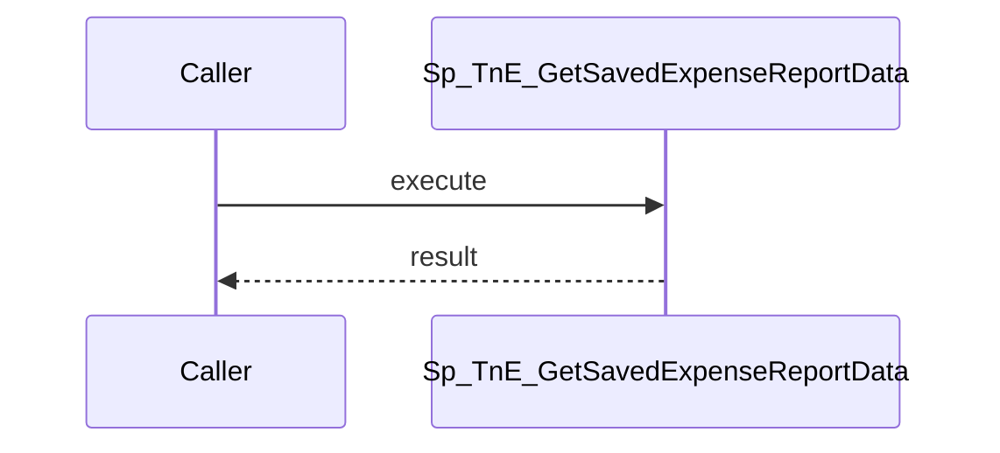
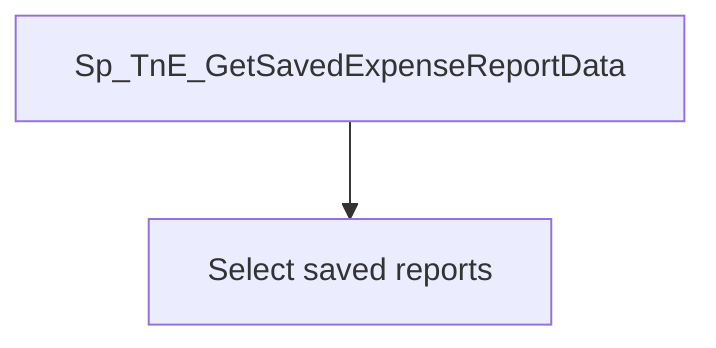

# Sp_TnE_GetSavedExpenseReportData

## What it does

Lists saved/managed expense report definitions for the login employee or reports shared with `-1`, scoped to employer CSV. Projects filter JSON fields into columns and resolves creator/updater display names.

## Parameters

| Name | Direction | What it is for |
|---|---|---|
| `@pEmployerId` | in | Employer id or CSV |
| `@LoginEmployeeId` | in | Owner employee id |

## Call sequence

## Callers

| Caller | Page |
|---|---|
| `ReportsDAL.GetExpenseSavedReportData` | [Report](/docs/guides/expense-and-reimbursement/report) |

## Nested

| Object | Kind | When | Page |
|---|---|---|---|
| `Fn_GetEmployeeName` | function | Createdby / Updatedby | [Fn_GetEmployeeName](/docs/database/hrms/Fn_GetEmployeeName) |

## Steps

1. Select from `ExpenseReportData` where owner matches or `Sharedwith='-1'`.
2. Restrict employers via `STRING_SPLIT`.
3. Extract filter JSON properties with `JSON_VALUE`.

## Tables

| Table | Read or write |
|---|---|
| `ExpenseReportData` / `ExpenseReportdata` | read |

## Unresolved calls

None beyond `Fn_GetEmployeeName`.

## Flow

