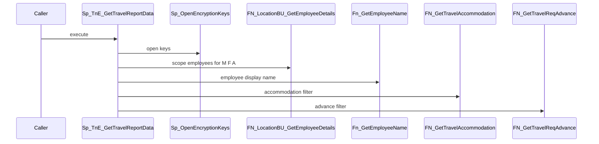
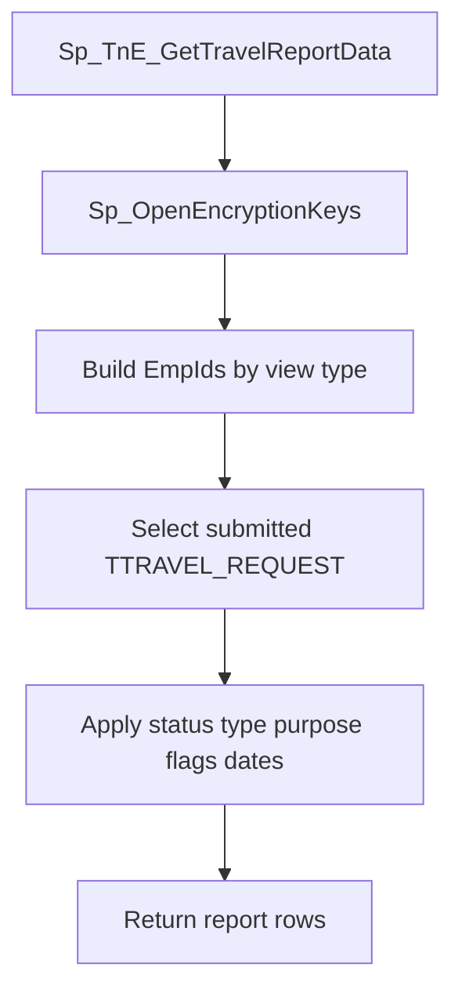

# Sp_TnE_GetTravelReportData

## What it does

Builds the **Travel Report** grid for submitted travel requests. Opens encryption keys, splits employer / travel-type / travel-purpose / status CSV filters, scopes employees by view type (self, manager/accountant, admin) with location-BU access, and returns distinct request rows with employment number, name, custom request id, type, purpose, bill-to, last modified date, current status text, and budget code.

## Parameters

| Name | Direction | What it is for |
|---|---|---|
| `@pEmployerId` | in | Employer id or CSV |
| `@pViewType` | in | `E` self, `M`/`F` manager or accountant, `A` admin; default `E` |
| `@pEmployeeId` | in | Actor used for view-type scoping |
| `@pStatusId` | in | CSV of status lookup ids; null means no status filter |
| `@pBillTo` | in | Optional bill-to filter |
| `@pIsAccomRequested` | in | Optional accommodation-present flag |
| `@pIsAdvanceRequested` | in | Optional advance-present flag |
| `@pFromDate` / `@pToDate` | in | Optional `EditedOn` date window |
| `@pTravelType` | in | Optional travel-type lookup; default both `151` and `152` |
| `@pTravelPurpose` | in | CSV of purpose lookup ids; default all purposes under parent `300` for selected employers |
| `@pBudgetCode` | in | Optional budget code |
| `@LoginEmployeeId` | in | Location-BU employee scope |

## Call sequence

## Callers

| Caller | Page |
|---|---|
| `ReportsDAL.GetTravelReportData` | [Report](/docs/guides/travel/report) |

## Nested

| Object | Kind | When | Page |
|---|---|---|---|
| `Sp_OpenEncryptionKeys` | procedure | start of procedure | [Sp_OpenEncryptionKeys](/docs/database/hrms/Sp_OpenEncryptionKeys) |
| `FN_LocationBU_GetEmployeeDetails` | function | view types `M`, `F`, `A` | [FN_LocationBU_GetEmployeeDetails](/docs/database/hrms/FN_LocationBU_GetEmployeeDetails) |
| `Fn_GetEmployeeName` | function | select list | [Fn_GetEmployeeName](/docs/database/hrms/Fn_GetEmployeeName) |
| `FN_GetTravelAccommodation` | function | accommodation filter | [FN_GetTravelAccommodation](/docs/database/hrms-travelnexpense/FN_GetTravelAccommodation) |
| `FN_GetTravelReqAdvance` | function | advance filter | [FN_GetTravelReqAdvance](/docs/database/hrms-travelnexpense/FN_GetTravelReqAdvance) |

## Steps

1. Script `HRMS-DATABASE/HRMS_TRAVELNEXPENSE/STOREPROCEDURE/Sp_TnE_GetTravelReportData.sql`; sets `READ UNCOMMITTED` and uses `NOLOCK` on lookup purpose default fill.
2. `EXEC Sp_OpenEncryptionKeys`; split `@pEmployerId` into `#EmployerIDs`.
3. Default travel types to `151`/`152` when `@pTravelType` is null; default purposes to `TLOOKUP` children of parent `300` when `@pTravelPurpose` is null.
4. Build `@EmpIds` from view type: self (`E`); functional manager / org-chart reportees plus self with `FN_LocationBU_GetEmployeeDetails` (`M`/`F`); all active/inactive employees in employer set with location-BU (`A`).
5. Select distinct submitted `TTRAVEL_REQUEST` rows joined to max `TTRAVEL_REQ_STATUS`, applying status/type/purpose/bill-to/accommodation/advance/date/budget filters; order by `EditedOn` desc.

## Tables

| Table | Read or write |
|---|---|
| `TTRAVEL_REQUEST` | read |
| `TTRAVEL_REQ_STATUS` | read |
| `TLOOKUP` | read |
| `TEMPLOYEE` / `TEmployee` | read |
| `TEmployeeInfo` / `TEMPLOYEEINFO` | read |
| `TORGChart` | read |
| `TTRAVEL_ACCOMMODATION` | read via `FN_GetTravelAccommodation` |
| `TTRAVEL_REQ_ADVANCE` | read via `FN_GetTravelReqAdvance` |

## Unresolved calls

None.

## Flow

