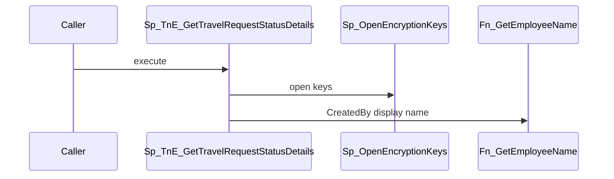
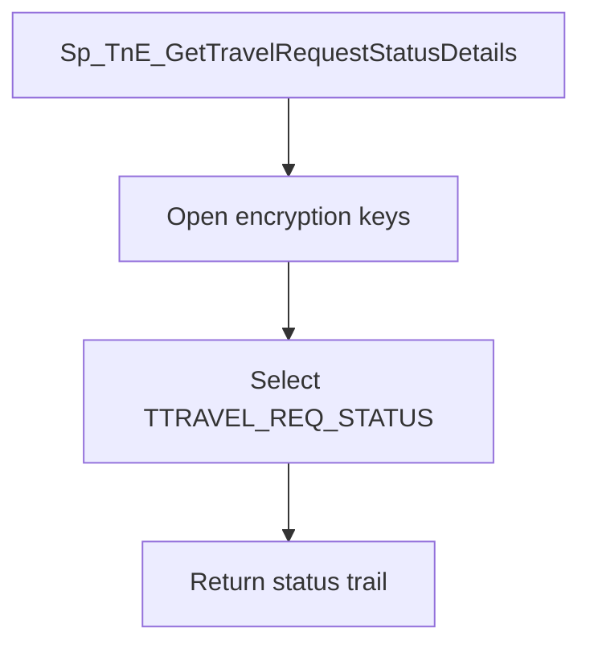

# Sp_TnE_GetTravelRequestStatusDetails

## What it does

Returns the status history trail for one travel request: status/sub-status, sub-status text from `TLOOKUP`, created-by name, comment, ordered newest first. Used when the dashboard opens “see updates” for a row.

## Parameters

| Name | Direction | What it is for |
|---|---|---|
| `@pTravelRequestId` | in | Travel request id |
| `@pEmployerId` | in | Employer for lookup text |

## Call sequence

## Callers

| Caller | Page |
|---|---|
| `TravelDAL.GetTravelRequestStatusDetails` | Travel Requests guide |

## Nested

| Object | Kind | When | Page |
|---|---|---|---|
| `Sp_OpenEncryptionKeys` | procedure | start of procedure | [Sp_OpenEncryptionKeys](/docs/database/hrms/Sp_OpenEncryptionKeys) |
| `Fn_GetEmployeeName` | function | each status row | [Fn_GetEmployeeName](/docs/database/hrms/Fn_GetEmployeeName) |

## Steps

1. Open encryption keys.
2. Select from `TTRAVEL_REQ_STATUS` for the request.
3. Resolve `SubStatusText` from `TLOOKUP` and `CreatedBy` via `Fn_GetEmployeeName`.

## Tables

| Table | Read or write |
|---|---|
| `TTRAVEL_REQ_STATUS` | read |
| `TLOOKUP` | read |

## Unresolved calls

Script does not call `SP_CloseEncryptionKey` after `Sp_OpenEncryptionKeys`.

## Flow

