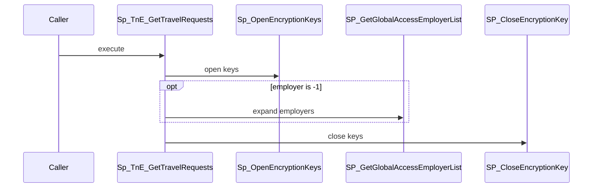
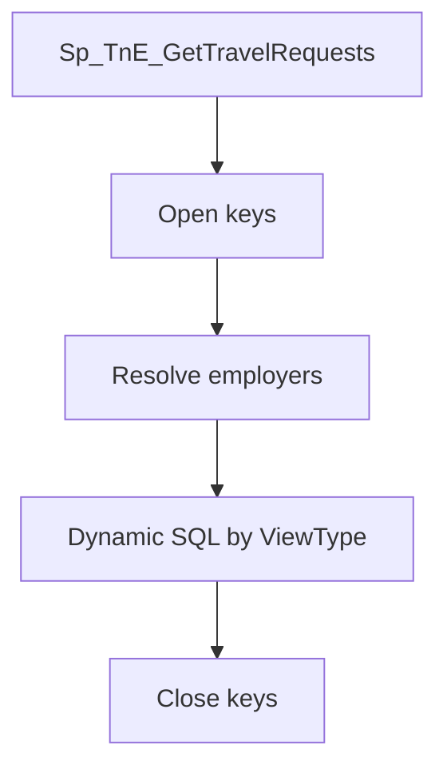

# Sp_TnE_GetTravelRequests

## What it does

Legacy travel-request list used by the **Advance Requests** tab (`viewType` `F`) and older list callers. Builds dynamic SQL over `TTRAVEL_REQUEST` scoped by employee, employer CSV/global access, view type, and optional filter type. Opens and closes encryption keys around the query.

## Parameters

| Name | Direction | What it is for |
|---|---|---|
| `@pEmployeeId` | in | Actor / filter employee id |
| `@pEmployerId` | in | Employer id, CSV, or `-1` |
| `@ViewType` | in | View mode (`E` employee, `F` finance/advance, etc.) |
| `@filterType` | in | Optional filter code |
| `@showInactiveEmployees` | in | Include inactive employees when 1 |

## Call sequence

## Callers

| Caller | Page |
|---|---|
| `TravelDAL.GetTravelRequestDetails` | Travel Requests guide (Advance Requests tab) |

## Nested

| Object | Kind | When | Page |
|---|---|---|---|
| `Sp_OpenEncryptionKeys` | procedure | start | [Sp_OpenEncryptionKeys](/docs/database/hrms/Sp_OpenEncryptionKeys) |
| `SP_GetGlobalAccessEmployerList` | procedure | `@pEmployerId = '-1'` | [SP_GetGlobalAccessEmployerList](/docs/database/hrms/SP_GetGlobalAccessEmployerList) |
| `SP_CloseEncryptionKey` | procedure | end | [SP_CloseEncryptionKey](/docs/database/hrms/SP_CloseEncryptionKey) |

Also uses `sys.sp_executesql` for the dynamic list statement.

## Steps

1. Open encryption keys and resolve employer set.
2. Build `@sqlTemp` for the requested `@ViewType` / `@filterType`.
3. Execute dynamic SQL and close encryption keys.

## Tables

| Table | Read or write |
|---|---|
| `TTRAVEL_REQUEST` | read |
| `TEMPLOYEE` | read |
| related travel status / schedule tables referenced in dynamic SQL | read |

## Unresolved calls

`sys.sp_executesql` is platform SQL, not documented as an HRMS object page.

## Flow

