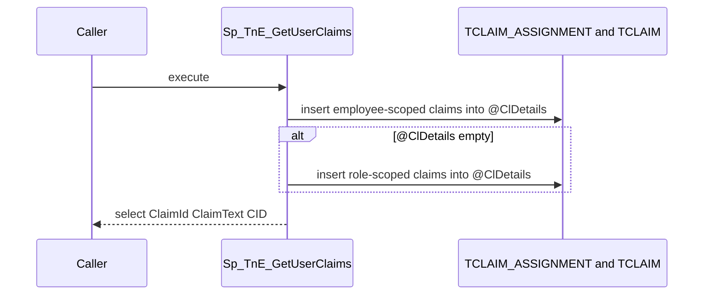
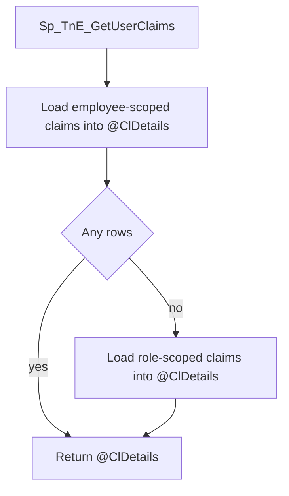

# Sp_TnE_GetUserClaims

## What it does

Returns the effective Travel & Expense claim list for one signed-in employee at one employer. It first loads claims assigned directly to `@pEmployeeId`. If that set is empty, it falls back to claims assigned to `@pRoleId` for the same employer. Each row is `ClaimId`, `ClaimText`, and short code `CID` (`ClaimText_Short`).

## Parameters

| Name | Direction | What it is for |
|---|---|---|
| `@pRoleId` | in | Role used when the employee has no employee-scoped claim rows |
| `@pEmployerid` | in | Employer that scopes `TCLAIM_ASSIGNMENT` |
| `@pEmployeeId` | in | Employee whose direct claim assignments are tried first |

## Call sequence

## Callers

No other procedure or function calls this object. App callers: `EmployeeDAL.GetTNEClaims` → `EmployeeBLL.GetTNEClaims` → `EmployeeController.GetTNEClaims`, invoked from every Travel & Expense React shell via `setupUser.js` (including [Petty Cash Management](/docs/guides/expense-and-reimbursement/petty-cash-management), Expense Requests, Permission Setup, and siblings).

## Nested

Calls no other procedures or functions.

## Steps

1. Script is `HRMS-DATABASE/HRMS_TRAVELNEXPENSE/STOREPROCEDURE/Sp_TnE_GetUserClaims.sql` (file header still contains `USE [TravelNExpense_Prod]`).
2. Create table variable `@ClDetails` (`ClaimId`, `ClaimText`, `CID`).
3. Insert claim rows joined from `TCLAIM_ASSIGNMENT` to `TCLAIM` where `EmployeeId = @pEmployeeId` and `Employerid = @pEmployerid`.
4. If `@ClDetails` has no rows, insert claim rows where `RoleId = @pRoleId` and `Employerid = @pEmployerid`.
5. Select `ClaimId`, `ClaimText`, `CID` from `@ClDetails`.
6. An older role-plus-org-chart branch is fully commented out above the live body and is not executed.

## Tables

| Table | Read or write |
|---|---|
| `TCLAIM_ASSIGNMENT` | read |
| `TCLAIM` | read |

## Unresolved calls

None.

## Flow

