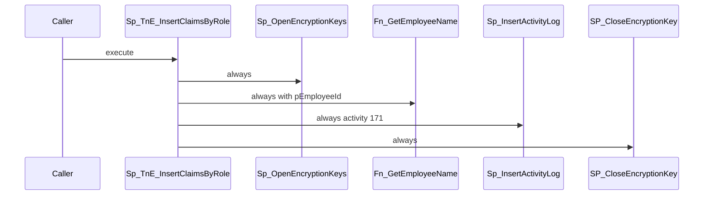
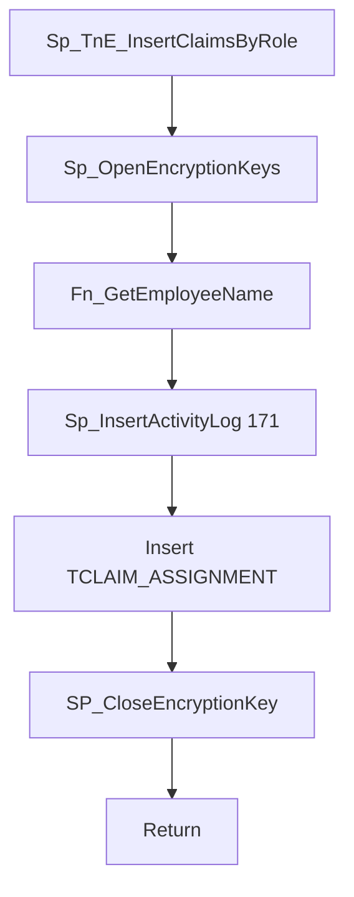

# Sp_TnE_InsertClaimsByRole

## What it does

Inserts one `TCLAIM_ASSIGNMENT` row for a claim, role, employer, and optional employee. Opens encryption keys, resolves an employee display name, writes activity type **171**, then inserts. Permission Setup calls it once per checked claim after a delete of the existing assignments for that role or employee.

## Parameters

| Name | Direction | What it is for |
|---|---|---|
| `@pClaimId` | in | Claim id inserted into `TCLAIM_ASSIGNMENT.ClaimID` |
| `@pRoleID` | in | Role id. Default null. Role saves send the role; employee saves send `0` |
| `@pEmployerId` | in | Employer id |
| `@pSearchType` | in | Search type from the API (`R` or `E`). Not used in the insert body |
| `@pEmployeeId` | in | Employee id. Default null. Role saves send `0` |

## Call sequence

## Callers

No other procedure or function calls this object. App callers: `EmployeeDAL.InsertClaimsBySearchType` (and legacy `InsertClaimsByRole`) from [Permission Setup](/docs/guides/admin-configuration/permission-setup) save.

## Nested

| Object | Kind | When | Page |
|---|---|---|---|
| `Sp_OpenEncryptionKeys` | procedure | always | [Sp_OpenEncryptionKeys](/docs/database/hrms/Sp_OpenEncryptionKeys) |
| `Fn_GetEmployeeName` | function | always | [Fn_GetEmployeeName](/docs/database/hrms/Fn_GetEmployeeName) |
| `Sp_InsertActivityLog` | procedure | always, activity type 171 | [Sp_InsertActivityLog](/docs/database/hrms/Sp_InsertActivityLog) |
| `SP_CloseEncryptionKey` | procedure | always | [SP_CloseEncryptionKey](/docs/database/hrms/SP_CloseEncryptionKey) |

## Steps

1. Script is `HRMS-DATABASE/HRMS_TRAVELNEXPENSE/STOREPROCEDURE/Sp_TnE_InsertClaimsByRole.sql`.
2. Execute `Sp_OpenEncryptionKeys`.
3. Resolve `@empname` with `Fn_GetEmployeeName(@pEmployeeId)` and build a comments string that includes the claim id.
4. Execute `Sp_InsertActivityLog` with activity type `171`.
5. Insert into `TCLAIM_ASSIGNMENT` (`ClaimID`, `RoleId`, `Employerid`, `EmployeeId`).
6. Execute `SP_CloseEncryptionKey`.

## Tables

| Table | Read or write |
|---|---|
| `TCLAIM_ASSIGNMENT` | write |

## Unresolved calls

None.

## Flow

