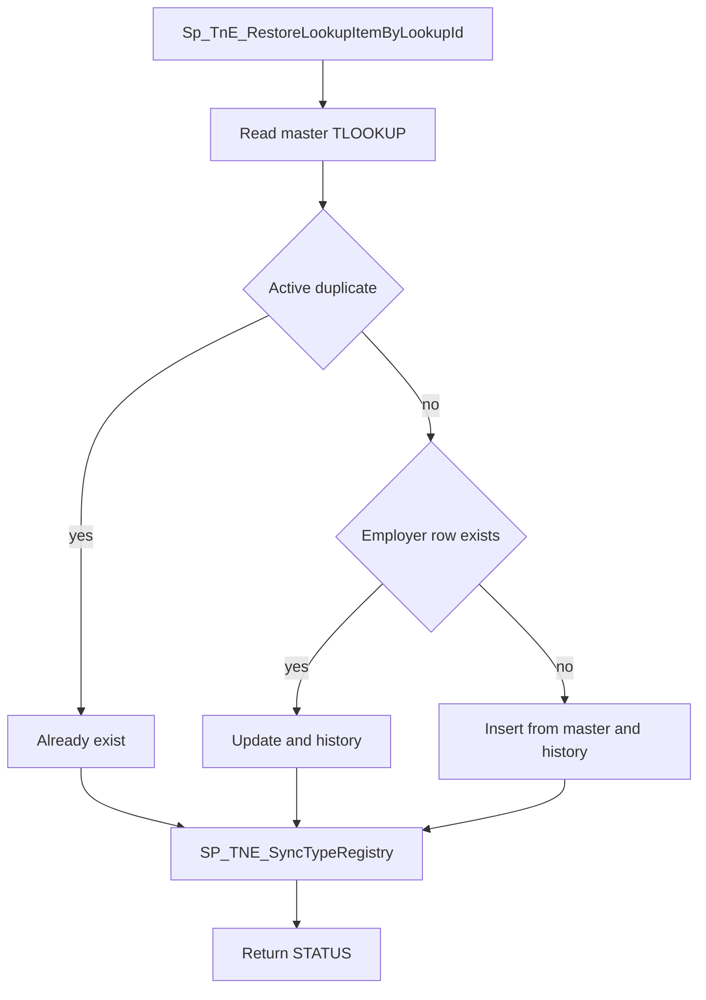

# Sp_TnE_RestoreLookupItemByLookupId

## What it does

Stored procedure `Sp_TnE_RestoreLookupItemByLookupId`. Restores an employer lookup from the master catalogue (`EmployerId = 0`): updates an existing employer row (including `isDeleted`) or inserts the master row when missing. Writes history, then always calls [`SP_TNE_SyncTypeRegistry`](/docs/database/hrms-travelnexpense/SP_TNE_SyncTypeRegistry). The DAL invokes this object as `SP_TNE_RestoreLookupItemByLookupId`.

## Parameters

| Name | Direction | What it is for |
|---|---|---|
| `@Lookup_Id` | in | INT |
| `@Lookup_Text` | in | NVARCHAR(500) — supplied by the API; master text drives restore |
| `@EmployerId` | in | INT |
| `@UpdatedBy` | in | INT |
| `@UpdatedOn` | in | DATETIME |

## Call sequence

1. [`SP_TNE_SyncTypeRegistry`](/docs/database/hrms-travelnexpense/SP_TNE_SyncTypeRegistry)

## Callers

No other procedure or function in this database calls this object. Application caller: Travel WebAPI `RestoreLookupItemByLookupId` via `TravelDAL.RestoreLookupItemByLookupId`.

| Caller | Page |
|---|---|
| (application only) | No page yet |

## Nested

| Object | Page |
|---|---|
| `SP_TNE_SyncTypeRegistry` | [`/docs/database/hrms-travelnexpense/SP_TNE_SyncTypeRegistry`](/docs/database/hrms-travelnexpense/SP_TNE_SyncTypeRegistry) |

## Steps

1. Script is `HRMS-DATABASE/HRMS_TRAVELNEXPENSE/STOREPROCEDURE/Sp_TnE_RestoreLookupItemByLookupId.sql`.
2. Load master text/parent/sub-parent/`isDeleted` for `@Lookup_Id`.
3. If employer already has an active row with that master text under the same parent/sub-parent, set already-exist status.
4. Else if employer has the lookup id, update text and `isDeleted` from master and write history.
5. Else insert the master row for the employer and write history.
6. Execute `SP_TNE_SyncTypeRegistry`, then return `STATUS` / `IsSuccess`.

## Tables

| Table | Read or write |
|---|---|
| `TLOOKUP` | read and write |
| `TLOOKUP_HISTORY` | write |

## Flow

