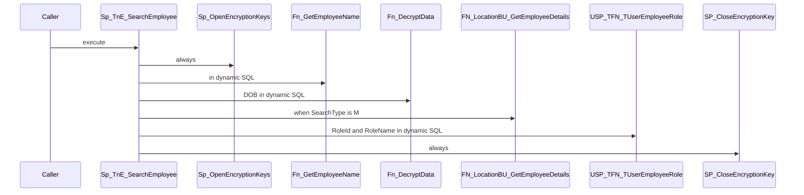
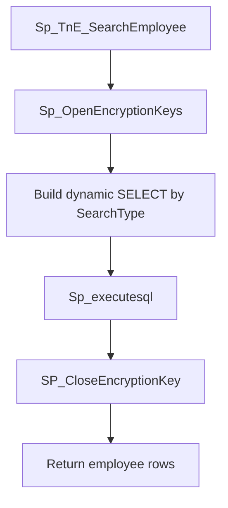

# Sp_TnE_SearchEmployee

## What it does

Builds and executes dynamic SQL that returns active employees for an employer for the Permission Setup employee picker. Search type `A` excludes the actor, `E` returns one employee, and `M` returns direct reports filtered by `FN_LocationBU_GetEmployeeDetails`. Each row includes name, employment number, designation, grade, managers, and role id/name.

## Parameters

| Name | Direction | What it is for |
|---|---|---|
| `@pEmployeeId` | in | Actor or target employee id depending on `@SearchType`. Default null |
| `@pEmployerid` | in | Employer filter on `TEmployee.Employerid` |
| `@pEmployeeName` | in | Optional name fragment. Default null |
| `@SearchType` | in | `A` all others, `E` exact employee, `M` manager reportees. Empty becomes `A` |
| `@CountryId` | in | Country filter for visa columns. Null becomes `-1` |

## Call sequence

## Callers

No other procedure or function calls this object. App callers: `EmployeeDAL.GetEmployeeDetails` → `EmployeeController.GetEmployeeDetails` from [Permission Setup](/docs/guides/admin-configuration/permission-setup) employee search.

## Nested

| Object | Kind | When | Page |
|---|---|---|---|
| `Sp_OpenEncryptionKeys` | procedure | always | [Sp_OpenEncryptionKeys](/docs/database/hrms/Sp_OpenEncryptionKeys) |
| `Fn_GetEmployeeName` | function | in dynamic SQL | [Fn_GetEmployeeName](/docs/database/hrms/Fn_GetEmployeeName) |
| `Fn_DecryptData` | function | DOB column | [Fn_DecryptData](/docs/database/hrms/Fn_DecryptData) |
| `FN_LocationBU_GetEmployeeDetails` | function | when `@SearchType = 'M'` | [FN_LocationBU_GetEmployeeDetails](/docs/database/hrms/FN_LocationBU_GetEmployeeDetails) |
| `USP_TFN_TUserEmployeeRole` | function | RoleId and RoleName columns | [USP_TFN_TUserEmployeeRole](/docs/database/hrms/USP_TFN_TUserEmployeeRole) |
| `SP_CloseEncryptionKey` | procedure | always | [SP_CloseEncryptionKey](/docs/database/hrms/SP_CloseEncryptionKey) |
| `Sp_executesql` | system | always for the built SELECT | system |

## Steps

1. Script is `HRMS-DATABASE/HRMS_TRAVELNEXPENSE/STOREPROCEDURE/Sp_TnE_SearchEmployee.sql`.
2. Execute `Sp_OpenEncryptionKeys`.
3. Optionally append a name `LIKE` filter using `Fn_GetEmployeeName`.
4. Build `@setFrom` for search types `A`, `E`, or `M` (manager path also uses `TORGChart`, `TEmployeeInfo.FunctionalManager`, and `FN_LocationBU_GetEmployeeDetails`).
5. Build a SELECT over `TEmployee`, `TEmployeeInfo`, and `TORGChart`, then `EXEC Sp_executesql`.
6. Execute `SP_CloseEncryptionKey`.

## Tables

| Table | Read or write |
|---|---|
| `TEmployee` | read (synonym) |
| `TEmployeeInfo` | read (synonym) |
| `TORGChart` | read (synonym) |
| `TOrgHierarchyDetails` | read (synonym) |
| `TGender` | read (synonym) |
| `TTitle` | read (synonym) |
| `TGrade` | read (synonym) |
| `TEmployeePassportDetails` | read (synonym) |
| `TEmployeeVisaInfo` | read (synonym) |
| `TCountry` | read (synonym) |
| `TVisaType` | read (synonym) |

## Unresolved calls

None.

## Flow

