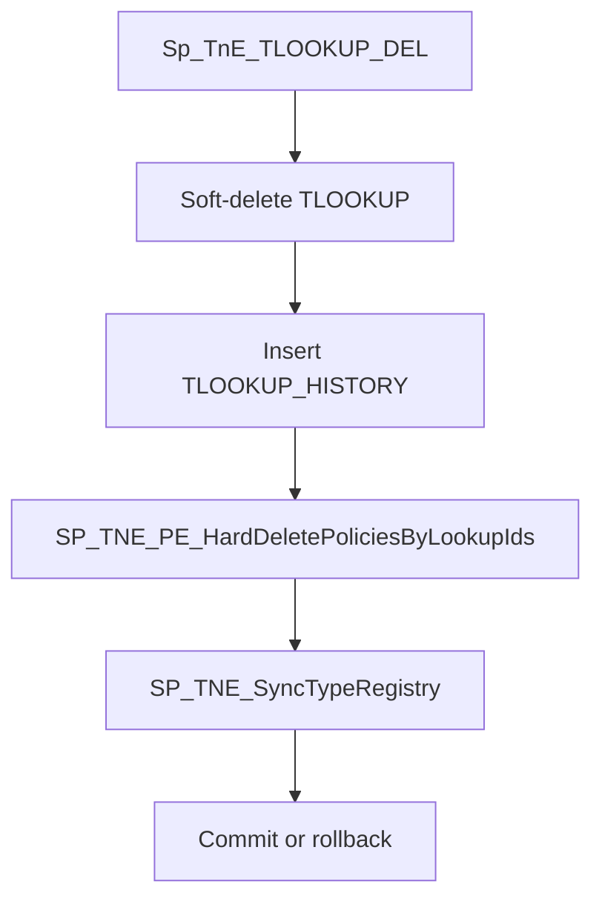

# Sp_TnE_TLOOKUP_DEL

## What it does

Stored procedure `Sp_TnE_TLOOKUP_DEL`. Soft-deletes one or more lookup ids for an employer (`isDeleted = 1`), writes history rows, hard-deletes related policy-engine rows for those lookup ids, then syncs the type registry. Runs in a transaction and returns success/failure status.

## Parameters

| Name | Direction | What it is for |
|---|---|---|
| `@LookupID` | in | VARCHAR(MAX) — comma-separated lookup ids |
| `@pEmployerid` | in | INT |
| `@UpdatedBy` | in | INT |
| `@UpdatedOn` | in | DATETIME |

## Call sequence

1. `SP_TNE_PE_HardDeletePoliciesByLookupIds` — script missing in this checkout
2. [`SP_TNE_SyncTypeRegistry`](/docs/database/hrms-travelnexpense/SP_TNE_SyncTypeRegistry)

## Callers

No other procedure or function in this database calls this object. Application caller: Travel WebAPI `RemoveLookupItem` via `TravelDAL.DeleteLookupItem`.

| Caller | Page |
|---|---|
| (application only) | No page yet |

## Nested

| Object | Page |
|---|---|
| `SP_TNE_PE_HardDeletePoliciesByLookupIds` | No page yet (SQL file not in `STOREPROCEDURE`) |
| `SP_TNE_SyncTypeRegistry` | [`/docs/database/hrms-travelnexpense/SP_TNE_SyncTypeRegistry`](/docs/database/hrms-travelnexpense/SP_TNE_SyncTypeRegistry) |

## Steps

1. Script is `HRMS-DATABASE/HRMS_TRAVELNEXPENSE/STOREPROCEDURE/Sp_TnE_TLOOKUP_DEL.sql`.
2. Begin transaction.
3. Update `TLOOKUP.isDeleted = 1` for ids from `STRING_SPLIT(@LookupID, ',')` and the employer.
4. Insert matching rows into `TLOOKUP_HISTORY` with `isDeleted = 1`.
5. Select success status (before nested calls complete the try block).
6. Execute hard-delete policies by lookup ids, then `SP_TNE_SyncTypeRegistry`.
7. On error, roll back and return failure status; otherwise commit.

## Tables

| Table | Read or write |
|---|---|
| `TLOOKUP` | read and write |
| `TLOOKUP_HISTORY` | write |

## Unresolved calls

- `SP_TNE_PE_HardDeletePoliciesByLookupIds` — referenced by `EXEC` but no matching file under `HRMS-DATABASE/HRMS_TRAVELNEXPENSE/STOREPROCEDURE` in this checkout.

## Flow

