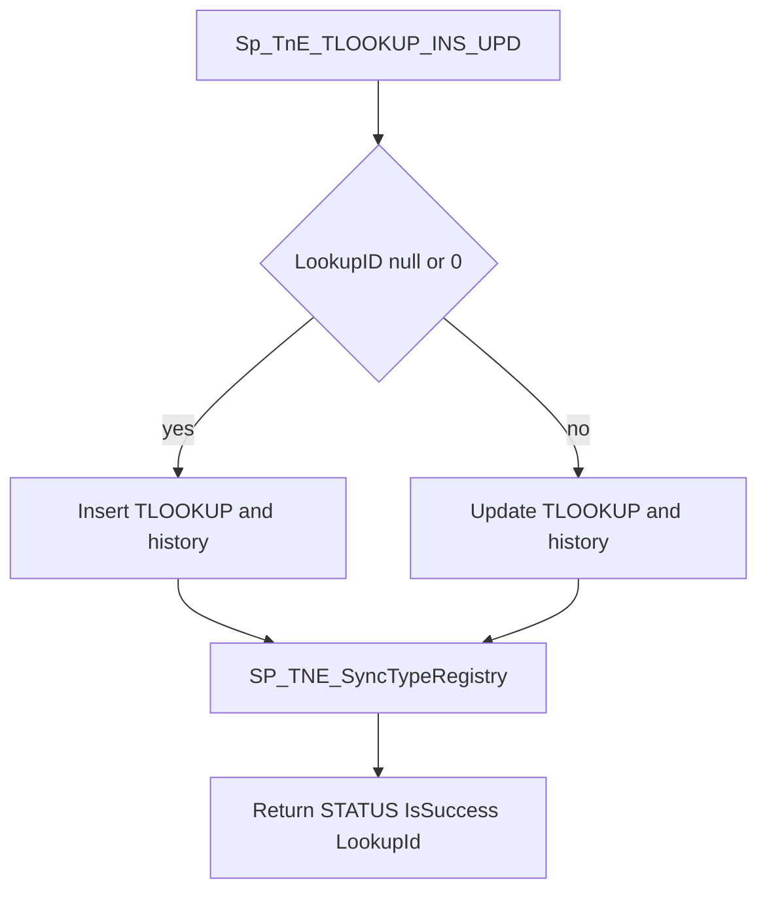

# Sp_TnE_TLOOKUP_INS_UPD

## What it does

Stored procedure `Sp_TnE_TLOOKUP_INS_UPD`. Inserts a new employer-scoped lookup when `@LookupID` is null/0, or updates an existing row. Blocks duplicates on text + parent + sub-parent for the employer. Writes `TLOOKUP_HISTORY` on success and calls [`SP_TNE_SyncTypeRegistry`](/docs/database/hrms-travelnexpense/SP_TNE_SyncTypeRegistry). Returns `STATUS`, `IsSuccess`, and `LookupId`.

## Parameters

| Name | Direction | What it is for |
|---|---|---|
| `@LookupID` | in | INT — 0/null means insert |
| `@LookupText` | in | NVARCHAR(50) |
| `@LookupParentId` | in | INT |
| `@Sub_Parent_ID` | in | INT |
| `@pEmployerid` | in | INT |
| `@AdditionalInfo` | in | NVARCHAR(500) |
| `@CostCenter` | in | NVARCHAR(500) |
| `@CreatedBy` | in | INT — also used as updater on update |
| `@CreatedOn` | in | DATETIME |
| `@LookupConfiguration` | in | NVARCHAR(MAX) |
| `@DisplayId` | in | INT |

## Call sequence

1. [`SP_TNE_SyncTypeRegistry`](/docs/database/hrms-travelnexpense/SP_TNE_SyncTypeRegistry) — after successful insert or update

## Callers

No other procedure or function in this database calls this object. Application caller: Travel WebAPI `SaveLookupData` via `TravelDAL.SaveLookupData`.

| Caller | Page |
|---|---|
| (application only) | No page yet |

## Nested

| Object | Page |
|---|---|
| `SP_TNE_SyncTypeRegistry` | [`/docs/database/hrms-travelnexpense/SP_TNE_SyncTypeRegistry`](/docs/database/hrms-travelnexpense/SP_TNE_SyncTypeRegistry) |

## Steps

1. Script is `HRMS-DATABASE/HRMS_TRAVELNEXPENSE/STOREPROCEDURE/Sp_TnE_TLOOKUP_INS_UPD.sql`.
2. When `@LookupID` is null or 0, compute next `Lookup_Id` as `MAX` for the employer plus one.
3. If that id is free and no duplicate text exists under the same parent/sub-parent, insert `TLOOKUP` and `TLOOKUP_HISTORY`, then sync type registry; else return already-exists failure.
4. When `@LookupID` is set, update text/config fields if no conflicting duplicate exists; insert history; sync type registry.
5. Select `@Status`, `@IsSuccess`, `@AddedLookupId`.

## Tables

| Table | Read or write |
|---|---|
| `TLOOKUP` | read and write |
| `TLOOKUP_HISTORY` | write |

## Flow

