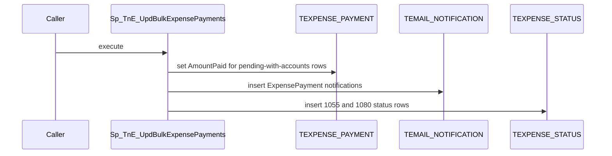
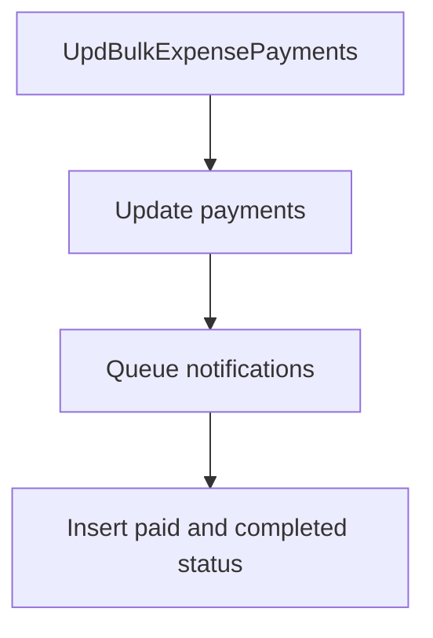

# Sp_TnE_UpdBulkExpensePayments

## What it does

Marks payment lines as paid for a CSV of expense ids that are currently in lookup text `Pending with Accounts`: sets `AmountPaid = AmountApproved`, stores comments/payment mode/editor, queues `ExpensePayment` email notification rows, and inserts status history for Amount Paid (1055) and Request Completed (1080).

## Parameters

| Name | Direction | What it is for |
|---|---|---|
| `@ExpenseIDs` | in | Comma-separated expense ids |
| `@Notes` | in | Payment comments |
| `@LoginID` | in | Actor employee id |
| `@PaidPaymentModeId` | in | Payment mode lookup |

## Call sequence

## Callers

App: `ExpenseDAL` execute of `Sp_TnE_UpdBulkExpensePayments` → `ExpenseController.UpdBulkExpensePayments` from Reimbursement tab on [Expense Requests](/docs/guides/expense-and-reimbursement/expense-requests).

## Nested

None.

## Steps

1. Script is `Sp_TnE_UpdBulkExpensePayments.sql`.
2. Update matching `TEXPENSE_PAYMENT` rows joined to expenses whose latest status text is `Pending with Accounts`; capture ids into `#PaidExpense`.
3. If any rows updated, insert `TEMAIL_NOTIFICATION` (`ExpensePayment`) and `TEXPENSE_STATUS` for 1055 then 1080 when missing.

## Tables

| Table | Read or write |
|---|---|
| `TEXPENSE_PAYMENT` | write |
| `TEXPENSE` | read |
| `TEXPENSE_STATUS` | read/write |
| `TLOOKUP` | read |
| `TEMAIL_NOTIFICATION` | write |

## Unresolved calls

None.

## Flow

