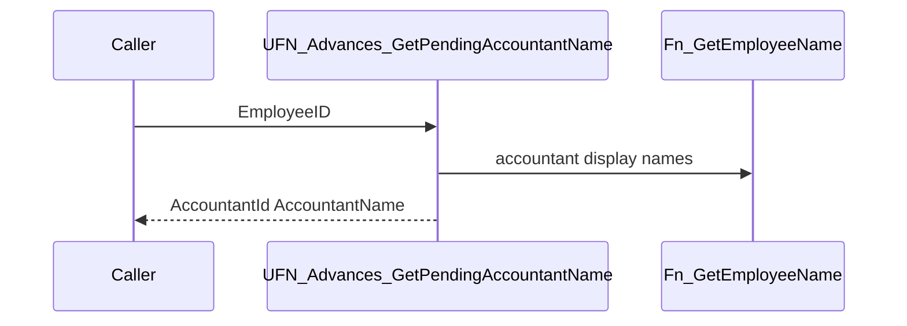
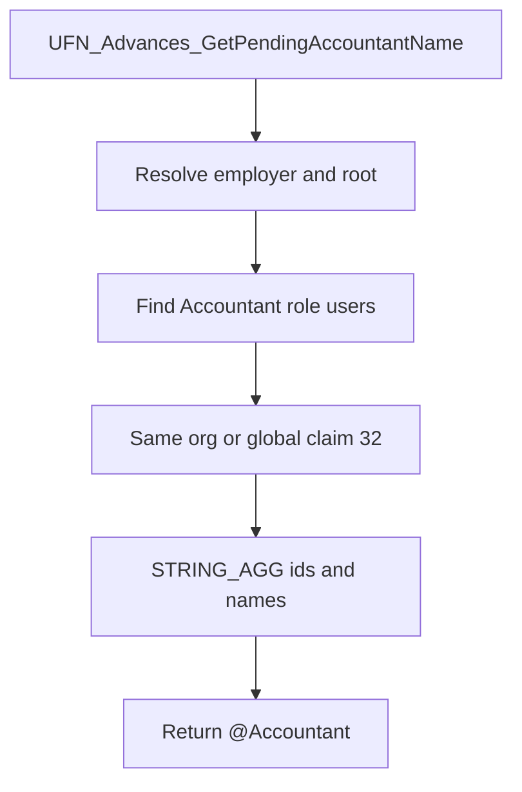

# UFN_Advances_GetPendingAccountantName

## What it does

Multi-statement table-valued function that returns one row of aggregated accountant ids and names for an advance request’s employee. Same-employer Accountant-role users are always included; accountants under the same root employer from other orgs are included only when `IsGlobalAccess = 'Y'` and claim id 32 (`TE032`) is assigned. Result columns are CSV `AccountantId` and `AccountantName`.

## Parameters

| Name | Direction | What it is for |
|---|---|---|
| `@EmployeeID` | in | Advance request employee whose employer/root scope drives the search |

## Call sequence

## Callers

| Object | Kind | Page |
|---|---|---|
| `SP_Advances_GetAdvanceReportData` | procedure | [SP_Advances_GetAdvanceReportData](/docs/database/hrms-travelnexpense/SP_Advances_GetAdvanceReportData) |

## Nested

| Object | Kind | When | Page |
|---|---|---|---|
| `Fn_GetEmployeeName` | function (synonym) | STRING_AGG of accountant names | [Fn_GetEmployeeName](/docs/database/hrms/Fn_GetEmployeeName) |

## Steps

1. Resolve `@EmployerID` from `TEmployeeInfo` for `@EmployeeID`.
2. Collect root-employer related employer ids into `@RootEmployerId`.
3. Find active employees with role name `Accountant` under that root set into `@ApproverNames`.
4. Keep same-employer accountants; add other-org accountants only with global access and `TCLAIM_ASSIGNMENT` claim 32.
5. `STRING_AGG` ids and `Fn_GetEmployeeName` into `@Accountant` and return.

## Tables

| Table | Read or write |
|---|---|
| `TEmployeeInfo` | read |
| `TEmployee` | read |
| `TEmployerDetails` | read |
| `TRoles` / `TUsers` / `TUserEmployee` | read |
| `TCLAIM_ASSIGNMENT` | read |

## Unresolved calls

None beyond `Fn_GetEmployeeName`.

## Flow

