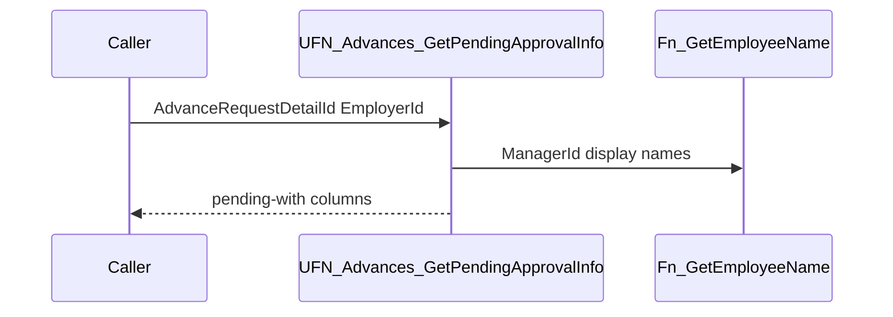
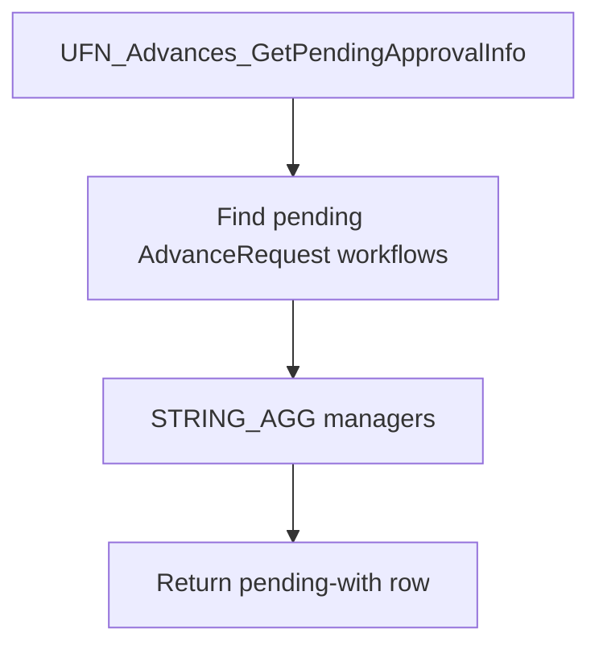

# UFN_Advances_GetPendingApprovalInfo

## What it does

Inline table-valued function that aggregates pending approvers for one advance request. Returns comma-separated `PendingWith` / `PendingWithName` / `PendingWithEmployeeId` from distinct pending `TREQUESTWORKFLOWS` managers at the current routing level, plus `routinglevels` and `APPROVESTATUS` from the matching workflow row.

## Parameters

| Name | Direction | What it is for |
|---|---|---|
| `@AdvanceRequestDetailId` | in | Advance request detail / `REQUESTTRANSID` |
| `@EmployerId` | in | Employer on `tworkflowmanagement` |

## Call sequence

## Callers

| Object | Kind | Page |
|---|---|---|
| `SP_Advances_GetAdvanceReportData` | procedure | [SP_Advances_GetAdvanceReportData](/docs/database/hrms-travelnexpense/SP_Advances_GetAdvanceReportData) |

## Nested

| Object | Kind | When | Page |
|---|---|---|---|
| `Fn_GetEmployeeName` | function (synonym) | STRING_AGG of manager display names | [Fn_GetEmployeeName](/docs/database/hrms/Fn_GetEmployeeName) |

## Steps

1. Script is `HRMS-DATABASE/HRMS_TRAVELNEXPENSE/FUNCTIONS/UFN_Advances_GetPendingApprovalInfo.sql` (file header still contains `USE [TravelNExpense_Prod]`).
2. Select distinct `ManagerId` from `TWorkflowDetails` × `tworkflowmanagement` × `TREQUESTWORKFLOWS` where `REQUESTTYPE = 'AdvanceRequest'`, `APPROVESTATUS = 'P'`, `ISAPPROVE = 0`, and routing level matches.
3. Aggregate names/ids with `STRING_AGG` via `Fn_GetEmployeeName`; cross join top pending routing level / approve status.

## Tables

| Table | Read or write |
|---|---|
| `TWorkflowDetails` | read |
| `tworkflowmanagement` | read |
| `TREQUESTWORKFLOWS` | read |

## Unresolved calls

None beyond `Fn_GetEmployeeName`.

## Flow

