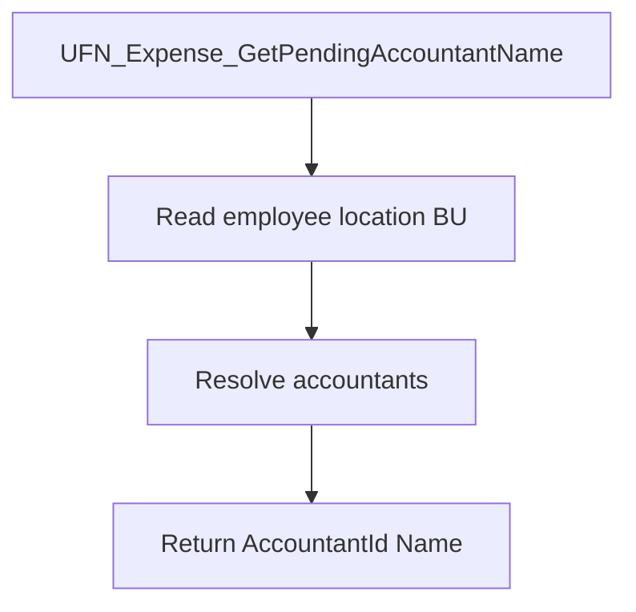

# UFN_Expense_GetPendingAccountantName

## What it does

Table-valued function that returns pending accountant id and display name for an employee’s expense, based on employee location/BU/employer and claim-assignment style accountant mapping (optimized Sep 2026 to avoid cartesian/STRING_SPLIT-per-row patterns). Used by list SPs when status is pending with accounts (1040).

## Parameters

| Name | Direction | What it is for |
|---|---|---|
| `@EmployeeID` | in | Subject employee (SubmittedFor) |

## Call sequence

Calls no other procedures. Reads employee info and accountant mapping tables inside the function body.

## Callers

| Object | Kind | Page |
|---|---|---|
| `SP_TNE_GetMyExpenseRequests` | procedure | [SP_TNE_GetMyExpenseRequests](/docs/database/hrms-travelnexpense/SP_TNE_GetMyExpenseRequests) |
| `SP_TNE_GetTeamExpenseRequests` | procedure | [SP_TNE_GetTeamExpenseRequests](/docs/database/hrms-travelnexpense/SP_TNE_GetTeamExpenseRequests) |
| `SP_TNE_AllExpenseRequests` | procedure | [SP_TNE_AllExpenseRequests](/docs/database/hrms-travelnexpense/SP_TNE_AllExpenseRequests) |
| `SP_TNE_GetReimbursementExpenseRequests` | procedure | [SP_TNE_GetReimbursementExpenseRequests](/docs/database/hrms-travelnexpense/SP_TNE_GetReimbursementExpenseRequests) |
| `SP_TNE_GetNotificationExpenseRequest` | procedure | [SP_TNE_GetNotificationExpenseRequest](/docs/database/hrms-travelnexpense/SP_TNE_GetNotificationExpenseRequest) |

## Nested

None documented at procedure EXEC level.

## Steps

1. Script is `UFN_Expense_GetPendingAccountantName.sql`.
2. Read BU/location/employer/root employer from `TEmployeeInfo` for `@EmployeeID`.
3. Resolve matching accountants for that scope into the returned table (`AccountantId`, `AccountantName`).

## Tables

| Table | Read or write |
|---|---|
| `TEmployeeInfo` | read |
| Accountant / claim-assignment related tables in function body | read |

## Unresolved calls

Detailed claim-assignment object names inside the optimized body were not exhaustively listed in this pass.

## Flow

