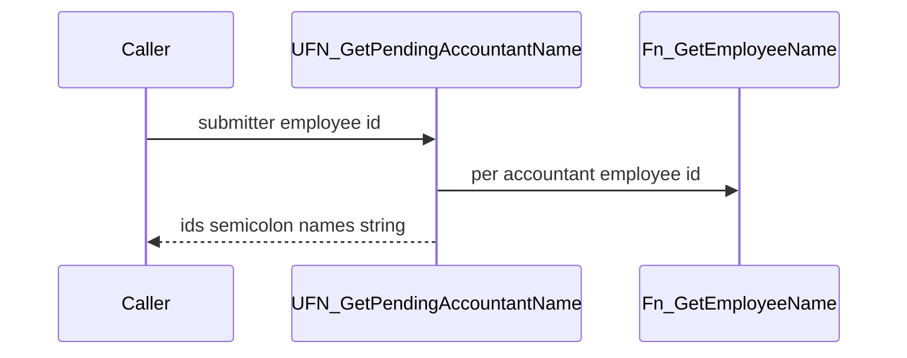
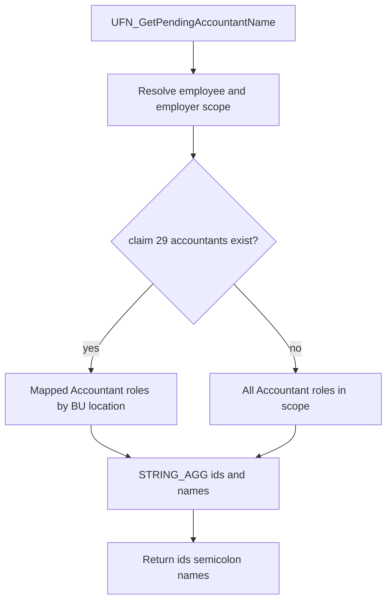

# UFN_GetPendingAccountantName

## What it does

Builds the pending-accountant string for an expense submitter: `employeeIds;names` via `STRING_AGG`, where names come from `Fn_GetEmployeeName`. Resolves the employee’s BU, location, employer, and root employer from `TEmployeeInfo`, scopes candidate employers (special-case root employers `253`/`255`/`256`), then picks active Accountant-role users. Prefer accountants tied to claim assignment `ClaimID = 29` with BU/location mapping; otherwise all Accountant-role users in scope.

## Parameters

| Name | Direction | What it is for |
|---|---|---|
| `@EmployeeID` | in | Expense submitter (`SubmittedFor`) whose accountants are resolved |

## Call sequence

## Callers

Procedures and functions that call this object.

| Object | Kind | Page |
|---|---|---|
| `Sp_TnE_ExpenseDashboard_Drill_Down_Grid` | procedure | [Sp_TnE_ExpenseDashboard_Drill_Down_Grid](/docs/database/hrms-travelnexpense/Sp_TnE_ExpenseDashboard_Drill_Down_Grid) |

## Nested

| Object | Kind | When | Page |
|---|---|---|---|
| `Fn_GetEmployeeName` | function | per accountant in the aggregate | [Fn_GetEmployeeName](/docs/database/hrms/Fn_GetEmployeeName) |

## Steps

1. Script is `HRMS-DATABASE/HRMS_TRAVELNEXPENSE/FUNCTIONS/UFN_GetPendingAccountantName.sql`.
2. Read BU, location, employer, root employer from `TEmployeeInfo`.
3. Build employer scope (full root tree for employers `253`/`255`/`256`, else self + root).
4. If claim-assignment accountants (`ClaimID = 29`) exist, select mapped Accountant-role users for BU/location; else select all Accountant-role users in scope.
5. Return `STRING_AGG` of ids, `;`, then `STRING_AGG` of `Fn_GetEmployeeName` values.

## Tables

| Table | Read or write |
|---|---|
| `TEmployeeInfo` | read (synonym) |
| `TEmployerDetails` | read (synonym) |
| `TCLAIM_ASSIGNMENT` | read |
| `TRoles`, `TUsers`, `TUserEmployee`, `TEmployee` | read (synonyms) |
| `TRolePagesMapping`, `TUserPagesMapping` | read (synonyms) |

## Unresolved calls

None.

## Flow

