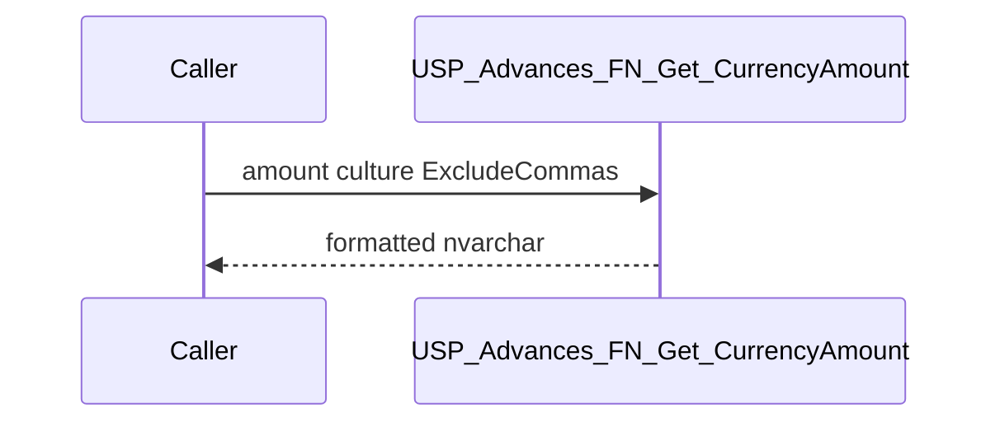
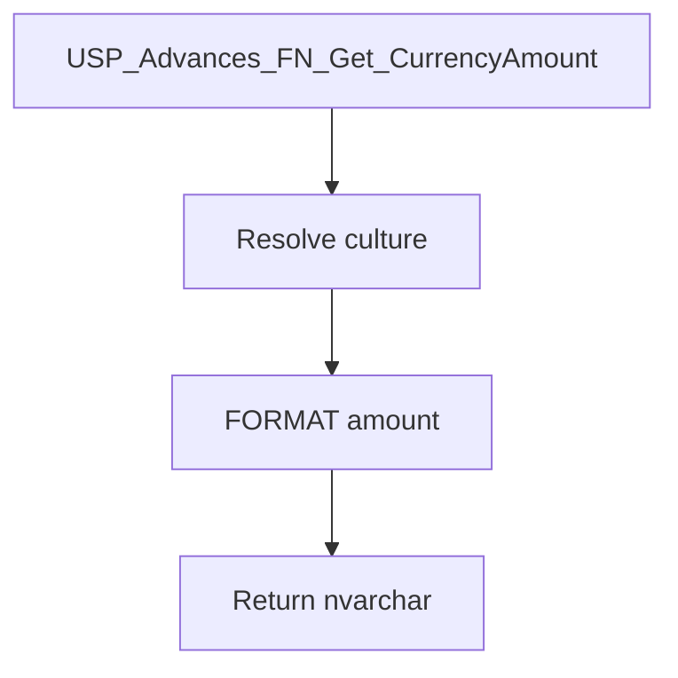

# USP_Advances_FN_Get_CurrencyAmount

## What it does

Formats a decimal amount as culture-aware text with SQL `FORMAT`. Defaults culture to `en-IN`. Cultures `en-FK`, `en-GI`, `en-VN`, and `en-FJ` fall back to `en-IN`. When `@ExcludeCommas = 1`, uses `F0`/`F` (no thousand separators); otherwise `N0`/`N`. Returns empty string behavior when amount is null (no format block).

## Parameters

| Name | Direction | What it is for |
|---|---|---|
| `@CurrencyAmount` | in | Amount to format |
| `@CurrencyCulture` | in | Culture name; default `en-IN` when null |
| `@ExcludeCommas` | in | `1` omits thousand separators; default `0` |

## Call sequence

## Callers

| Object | Kind | Page |
|---|---|---|
| `SP_Advances_GetAdvanceReportData` | procedure | [SP_Advances_GetAdvanceReportData](/docs/database/hrms-travelnexpense/SP_Advances_GetAdvanceReportData) |

Other advance list/detail procedures may also call this function; this page was written for the Report nested level.

## Nested

Calls no other procedures or functions.

## Steps

1. Script is `HRMS-DATABASE/HRMS_TRAVELNEXPENSE/FUNCTIONS/USP_Advances_FN_Get_CurrencyAmount.sql` (file header still contains `USE [TravelNExpense_Prod]`).
2. Default `@CurrencyCulture` to `en-IN`; remap the four fallback cultures.
3. If amount is not null, `FORMAT` with or without thousand separators per `@ExcludeCommas`; return the string.

## Tables

None.

## Unresolved calls

None.

## Flow

