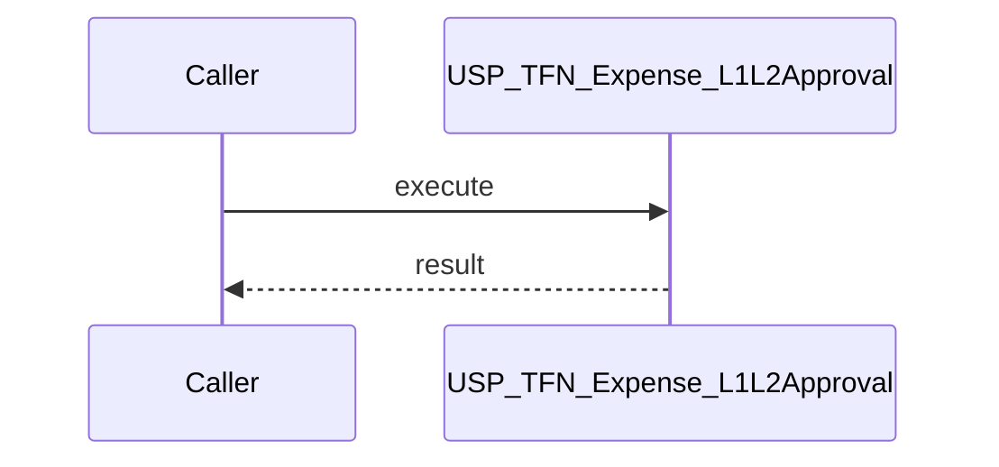
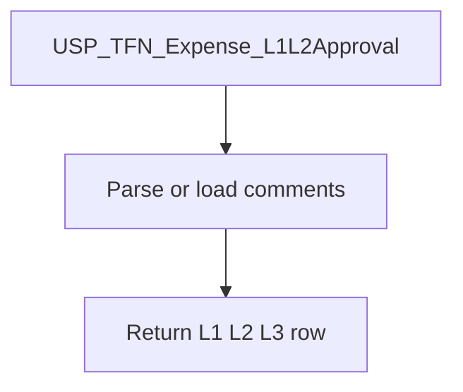

# USP_TFN_Expense_L1L2Approval

## What it does

Table-valued function that derives L1/L2/L3 approver names and comments for an expense request. Used via `OUTER APPLY` in `Sp_TnE_GetExpenseReportData`.

## Parameters

| Name | Direction | What it is for |
|---|---|---|
| `@String` | in | Approver comments HTML/text |
| `@EmployerID` | in | Employer |
| `@pExpenseRequestId` | in | Expense id |

## Call sequence

## Callers

| Caller | Page |
|---|---|
| `Sp_TnE_GetExpenseReportData` | [Sp_TnE_GetExpenseReportData](/docs/database/hrms-travelnexpense/Sp_TnE_GetExpenseReportData) |

## Nested

May read expense approver comment tables in-body; no nested procedure `EXEC`.

## Steps

1. Parse comment string and/or load structured approver comments for the expense.
2. Return one table row with L1/L2/L3 approver and comment columns.

## Tables

| Table | Read or write |
|---|---|
| Approver comment tables referenced in function body | read |

## Unresolved calls

None.

## Flow

