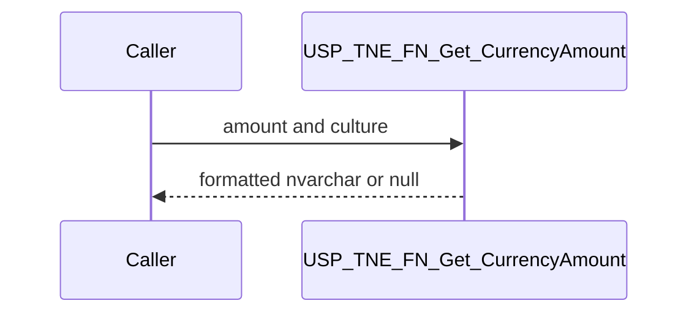
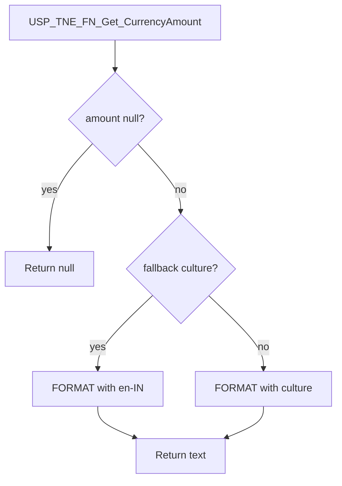

# USP_TNE_FN_Get_CurrencyAmount

## What it does

Formats a decimal amount as culture-aware text with `FORMAT(..., 'N', @CurrencyCulture)`. Defaults culture to `en-IN`. Cultures `en-FK`, `en-GI`, `en-VN`, and `en-FJ` fall back to `en-IN`. Returns NULL when `@CurrencyAmount` is NULL.

## Parameters

| Name | Direction | What it is for |
|---|---|---|
| `@CurrencyAmount` | in | Amount to format |
| `@CurrencyCulture` | in | .NET/SQL culture name; default `en-IN` when null |

## Call sequence

## Callers

Procedures and functions that call this object.

| Object | Kind | Page |
|---|---|---|
| `Sp_TnE_ExpenseDashboard_ChartInformation` | procedure | [Sp_TnE_ExpenseDashboard_ChartInformation](/docs/database/hrms-travelnexpense/Sp_TnE_ExpenseDashboard_ChartInformation) |
| `Sp_TnE_ExpenseDashboard_Drill_Down_Grid` | procedure | [Sp_TnE_ExpenseDashboard_Drill_Down_Grid](/docs/database/hrms-travelnexpense/Sp_TnE_ExpenseDashboard_Drill_Down_Grid) |

## Nested

Calls no other procedures or functions.

## Steps

1. Script is `HRMS-DATABASE/HRMS_TRAVELNEXPENSE/FUNCTIONS/USP_TNE_FN_Get_CurrencyAmount.sql` (file header still contains `USE [TravelNExpense_Prod]`).
2. Default `@CurrencyCulture` to `en-IN` when null.
3. If amount is not null, `FORMAT` with the culture, or with `en-IN` for the four fallback cultures; return the string.

## Tables

None.

## Unresolved calls

None.

## Flow

