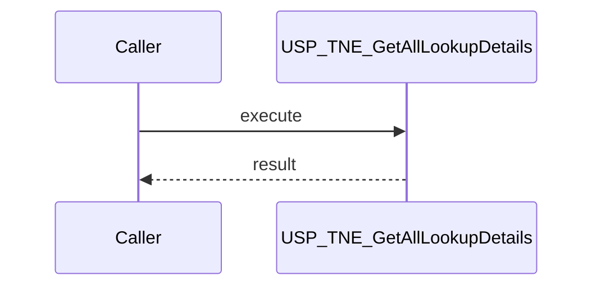
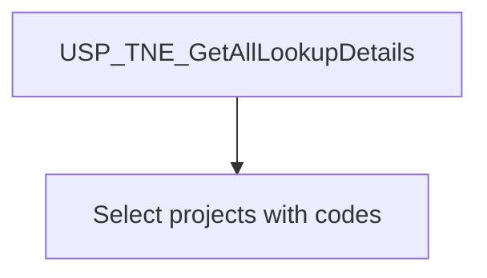

# USP_TNE_GetAllLookupDetails

## What it does

Returns project name/code pairs (plus work location id) for an employer from `TProject` joined to `TProjectConfDetails`, used by Report project/cost-center filters.

## Parameters

| Name | Direction | What it is for |
|---|---|---|
| `@pEmployerId` | in | Employer scope |

## Call sequence

## Callers

| Caller | Page |
|---|---|
| `EmployeeDAL.GetProjectNamesandCodes` | [Report](/docs/guides/expense-and-reimbursement/report) |

## Nested

Calls no other procedures or functions.

## Steps

1. Select distinct projects for employer where project code is non-empty.
2. Left join `TProjectConfDetails` on project id.

## Tables

| Table | Read or write |
|---|---|
| `TProject` | read |
| `TProjectConfDetails` | read |

## Unresolved calls

None.

## Flow

