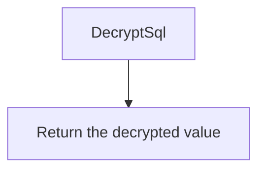

# DecryptSql

## What it does

CLR function. It decrypts one nvarchar value by calling HRMSSql.SecurityEncriptDecryptForSqlServer.DecryptValue. The SQL script has no T-SQL body.

## Parameters

| Name | Direction | What it is for |
|---|---|---|
| `@inputOne` | in | Encrypted value |

## Call sequence

Calls no other procedures or functions.

## Callers

Procedures and functions that call this object.

| Object | Kind | Page |
|---|---|---|
| `SP_Get_BudgetUtilizationDetails` | procedure | No page yet |
| `SP_GetDirectAddedCandidates` | procedure | No page yet |
| `SP_GetEmployeeLetterDetails` | procedure | [SP_GetEmployeeLetterDetails](/docs/database/hrms/SP_GetEmployeeLetterDetails) |
| `Sp_GetEmpSummaryRpt` | procedure | No page yet |
| `SP_GetPendingOfferRolledOut` | procedure | No page yet |
| `SP_GetPMSEmployeeAppraisalReport` | procedure | No page yet |
| `SP_PMS_GetEmployeeAppraisalReport` | procedure | No page yet |
| `SP_PMS_ParkPMSEmployeeAppraisalReportData` | procedure | No page yet |
| `SP_RPT_GetCandidateCompensation` | procedure | No page yet |
| `SP_RPT_GetEmployeeCompensation` | procedure | No page yet |
| `Sp_RRS_GetCandidateDashboard` | procedure | No page yet |
| `SP_RRS_GetCandidateDashboardNEW` | procedure | No page yet |
| `Sp_RRS_GetHrCandidateDetails` | procedure | No page yet |
| `Sp_RRS_UpdateChildDetails` | procedure | No page yet |
| `Sp_RRS_UpdateDetails` | procedure | No page yet |
| `Sp_RRS_UpdateInitiateHiring` | procedure | No page yet |
| `UFN_GetAvailableAndUtilizedBudget` | function | No page yet |
| `USP_FN_Get_CurrencyAmount` | procedure | No page yet |
| `USP_GetEmailplaceHolder` | procedure | No page yet |
| `USP_RRS_ESS_GetTempDocForEmailNotification` | procedure | No page yet |
| `usp_vw_OfferRolledOutCandidateDetails` | procedure | No page yet |
| `usp_vw_RRSCandidateOfferLetter` | procedure | No page yet |
| `usp_vw_RRSCandidateOfferLetterEmail` | procedure | No page yet |
| `usp_vw_RRSInitiateHiring` | procedure | No page yet |
| `usp_VW_UserCreation` | procedure | No page yet |

## Nested

Calls no other procedures or functions.

## Steps

1. Return the CLR decrypt result for `@inputOne` (`DecryptSql.sql`).

## Tables

No table is read or written.

## Flow

