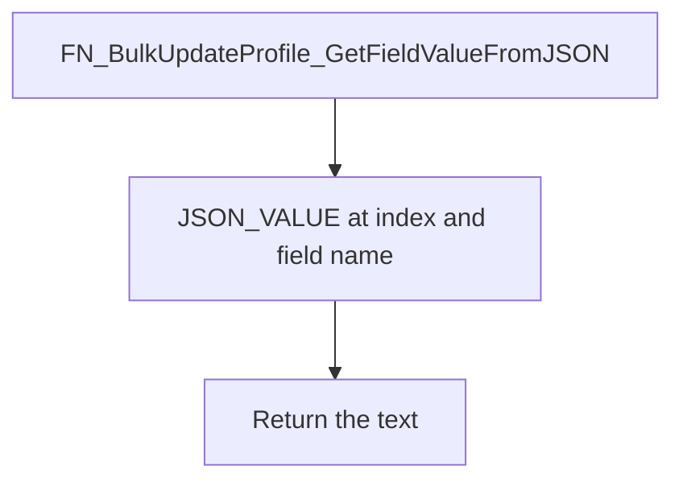

# FN_BulkUpdateProfile_GetFieldValueFromJSON

## What it does

Returns one JSON property from an employee payload array. The path is `$[index]."FieldName"` using `JSON_VALUE`.

## Parameters

| Name | Direction | What it is for |
|---|---|---|
| `@EmployeeData` | in | JSON array text |
| `@FieldName` | in | Property name, quoted into the path |
| `@Index` | in | Zero-based array index |

## Call sequence

Calls no other procedures or functions.

## Steps

1. Build the path `$[index]."FieldName"` and return `JSON_VALUE` (`FUNCTIONS/FN_BulkUpdateProfile_GetFieldValueFromJSON.sql`).

## Tables

Reads and writes no tables.

## Procedures and functions it calls

Calls no other procedures or functions.

## Flow

