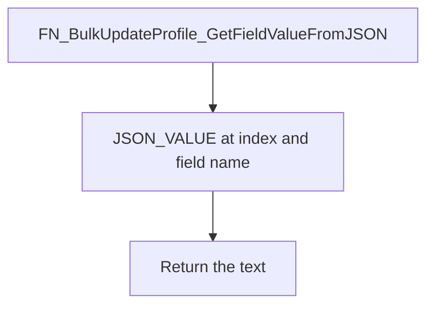

# FN_BulkUpdateProfile_GetFieldValueFromJSON

## What it does

Returns one JSON property from an employee payload array. The path is `$[index]."FieldName"` using `JSON_VALUE`.

## Parameters

| Name | Direction | What it is for |
|---|---|---|
| `@EmployeeData` | in | JSON array text |
| `@FieldName` | in | Property name, quoted into the path |
| `@Index` | in | Zero-based array index |

## Call sequence

Calls no other procedures or functions.

## Callers

| Object | Kind | Page |
|---|---|---|
| `FN_BulkCreateProfile_BuildInsertDetailsSQL` | function | No page yet |
| `FN_BulkEmployeeCreationUpdateSQL` | function | No page yet |
| `FN_BulkUpdateProfile_BuildCurrentEmployment_ErrorValidation` | function | No page yet |
| `FN_BulkUpdateProfile_BuildCurrentEmployment_InsertSQL` | function | No page yet |
| `FN_BulkUpdateProfile_BuildCurrentEmployment_UpdateSQL` | function | No page yet |
| `FN_BulkUpdateProfile_BuildInsertCertificationDetailsSQL` | function | No page yet |
| `FN_BulkUpdateProfile_BuildInsertContactDetailsSQL` | function | No page yet |
| `FN_BulkUpdateProfile_BuildInsertDomainDetailsSQL` | function | No page yet |
| `FN_BulkUpdateProfile_BuildInsertEducationDetailsSQL` | function | No page yet |
| `FN_BulkUpdateProfile_BuildInsertEmergencyContactDetailsSQL` | function | No page yet |
| `FN_BulkUpdateProfile_BuildInserTEmployeeBankDetailsSQL` | function | No page yet |
| `FN_BulkUpdateProfile_BuildInsertFamilyDetailsSQL` | function | No page yet |
| `FN_BulkUpdateProfile_BuildInsertNominationDetailsSQL` | function | No page yet |
| `FN_BulkUpdateProfile_BuildInsertPassportDetailsSQL` | function | No page yet |
| `FN_BulkUpdateProfile_BuildInsertPastEmploymentDetailsSQL` | function | No page yet |
| `FN_BulkUpdateProfile_BuildInsertSkillDetailsSQL` | function | No page yet |
| `FN_BulkUpdateProfile_BuildInsertVisaDetailsSQL` | function | No page yet |
| `FN_BulkUpdateProfile_BuildPassportDetails_UpdateSQL` | function | No page yet |
| `FN_BulkUpdateProfile_BuildPersonalDetail_UpdateSQL` | function | No page yet |
| `FN_BulkUpdateProfile_BuildUpdateBankDetailsSQL` | function | No page yet |
| `FN_BulkUpdateProfile_BuildUpdateCertificationDetailsSQL` | function | No page yet |
| `FN_BulkUpdateProfile_BuildUpdateContactDetailsSQL` | function | No page yet |
| `FN_BulkUpdateProfile_BuildUpdateDomainDetailsSQL` | function | No page yet |
| `FN_BulkUpdateProfile_BuildUpdateEducationDetailsSQL` | function | No page yet |
| `FN_BulkUpdateProfile_BuildUpdateEmergencyContactDetailsSQL` | function | No page yet |
| `FN_BulkUpdateProfile_BuildUpdateFamilyDetailsSQL` | function | No page yet |
| `FN_BulkUpdateProfile_BuildUpdateNominationDetailsSQL` | function | No page yet |
| `FN_BulkUpdateProfile_BuildUpdatePastEmploymentDetailsSQL` | function | No page yet |
| `FN_BulkUpdateProfile_BuildUpdateSkillDetailsSQL` | function | No page yet |
| `FN_BulkUpdateProfile_BuildUpdateVisaDetailsSQL` | function | No page yet |
| `FN_Mydetails_Enhanced_BuildCurrentEmployment_ErrorValidation` | function | No page yet |
| `FN_Mydetails_Enhanced_BuildCurrentEmployment_InsertSQL` | function | No page yet |
| `FN_Mydetails_Enhanced_BuildCurrentEmployment_UpdateSQL` | function | No page yet |
| `FN_Mydetails_Enhanced_BuildInsertCertificationDetailsSQL` | function | No page yet |
| `FN_Mydetails_Enhanced_BuildInsertcontactDetailsSQL` | function | No page yet |
| `FN_Mydetails_Enhanced_BuildInsertEducationDetailsSQL` | function | No page yet |
| `FN_Mydetails_Enhanced_BuildInsertEmergencyContactDetailsSQL` | function | No page yet |
| `FN_Mydetails_Enhanced_BuildInserTEmployeeBankDetailsSQL` | function | No page yet |
| `FN_Mydetails_Enhanced_BuildInsertFamilyDetailsSQL` | function | [FN_Mydetails_Enhanced_BuildInsertFamilyDetailsSQL](/docs/database/hrms/FN_Mydetails_Enhanced_BuildInsertFamilyDetailsSQL) |
| `FN_Mydetails_Enhanced_BuildInsertNominationDetailsSQL` | function | No page yet |
| `FN_Mydetails_Enhanced_BuildInsertNomineeDetailsSQL` | function | No page yet |
| `FN_Mydetails_Enhanced_BuildInsertPastEmploymentDetailsSQL` | function | No page yet |
| `FN_Mydetails_Enhanced_BuildInsertVisaDetailsSQL` | function | No page yet |
| `FN_Mydetails_Enhanced_BuildPassportDetails_UpdateSQL` | function | No page yet |
| `FN_Mydetails_Enhanced_Buildpersonalsect_UpdateSQL` | function | No page yet |
| `FN_Mydetails_Enhanced_BuildUpdateBankDetailsSQL` | function | No page yet |
| `FN_Mydetails_Enhanced_BuildUpdateCertificationDetailsSQL` | function | No page yet |
| `FN_Mydetails_Enhanced_BuildUpdatecontactDetailsSQL` | function | No page yet |
| `FN_Mydetails_Enhanced_BuildUpdateEducationDetailsSQL` | function | No page yet |
| `FN_Mydetails_Enhanced_BuildUpdateEmergencyContactDetailsSQL` | function | No page yet |
| `FN_Mydetails_Enhanced_BuildUpdateFamilyDetailsSQL` | function | [FN_Mydetails_Enhanced_BuildUpdateFamilyDetailsSQL](/docs/database/hrms/FN_Mydetails_Enhanced_BuildUpdateFamilyDetailsSQL) |
| `FN_Mydetails_Enhanced_BuildUpdateNominationDetailsSQL` | function | No page yet |
| `FN_Mydetails_Enhanced_BuildUpdateNomineeDetailsSQL` | function | No page yet |
| `FN_Mydetails_Enhanced_BuildUpdatePastEmploymentDetailsSQL` | function | No page yet |
| `FN_Mydetails_Enhanced_BuildUpdateVisaDetailsSQL` | function | No page yet |
| `SP_BulkCreateProfile_InsertCustomFieldValues` | procedure | No page yet |
| `SP_BulkUpdateProfile_UpdateCustomFieldValues` | procedure | No page yet |
| `SP_Mydetails_Enhanced_UpdateCustomFieldValues` | procedure | [SP_Mydetails_Enhanced_UpdateCustomFieldValues](/docs/database/hrms/SP_Mydetails_Enhanced_UpdateCustomFieldValues) |

## Nested

Calls no other procedures or functions.

## Steps

1. Build the path `$[index]."FieldName"` and return `JSON_VALUE` (`FUNCTIONS/FN_BulkUpdateProfile_GetFieldValueFromJSON.sql`).

## Tables

Reads and writes no tables.

## Flow

