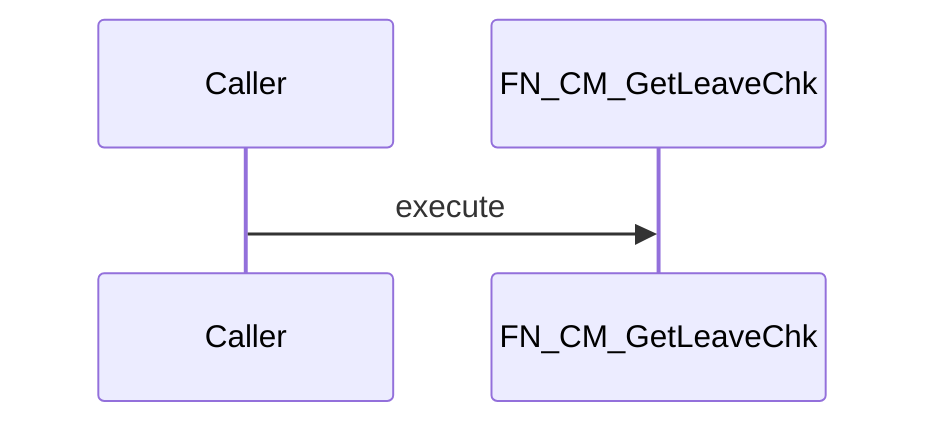
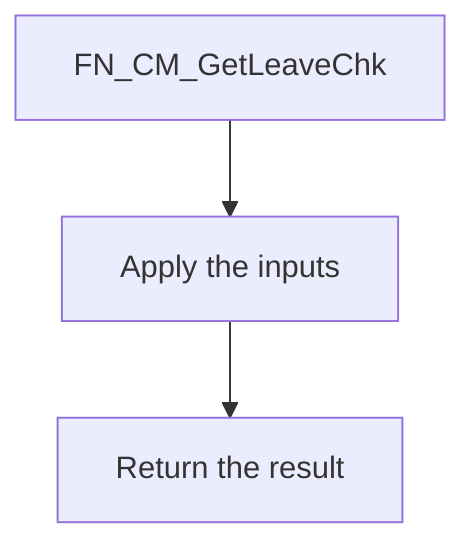

# FN_CM_GetLeaveChk

## What it does

Helper called by a Home dashboard procedure. It reads TLeaveRequest, TLeaveRequestDays and returns that result to its caller.

## Parameters

| Name | Direction | What it is for |
|---|---|---|
| `@AttendanceDate` | in | Input used by this procedure (`DATE`) |
| `@EmployeeId` | in | Employee the Home screen is loading or acting for (`INT`) |

## Call sequence

## Callers

| Object | Kind | Page |
|---|---|---|
| `SP_AttendanceSummary_Employerwise` | procedure | No page yet |
| `SP_DB_EmployeeAttendanceDetails` | procedure | [SP_DB_EmployeeAttendanceDetails](/docs/database/hrms/SP_DB_EmployeeAttendanceDetails) |
| `SP_DB_EmployeeAttendanceDetails_HT` | procedure | No page yet |
| `SP_DB_EmployeeAttendanceFromEmailDetails` | procedure | No page yet |
| `SP_DB_EmployeeDayWiseAttendanceDetails` | procedure | No page yet |
| `Sp_Geo_GetTrackingConfiguration` | procedure | No page yet |
| `Sp_GetAttendanceDateWise` | procedure | No page yet |
| `SP_GetHomePageDetails1` | procedure | No page yet |
| `SP_GetTeamAttendanceDetails` | procedure | No page yet |
| `USP_GetEmployeeLeaveAttendanceDetails` | procedure | No page yet |
| `USP_GetEmployeeLeaveAttendanceDetails_HT` | procedure | No page yet |

## Nested

This object does not execute another procedure or user-defined function.

## Steps

In `HRMS-DATABASE/HRMS/FUNCTIONS/FN_CM_GetLeaveChk.sql`:

1. Read `TLeaveRequest`, `TLeaveRequestDays`.
2. Return the result set to the caller.

## Tables

| Table | Read or write |
|---|---|
| `TLeaveRequest` | read |
| `TLeaveRequestDays` | read |

## Flow

