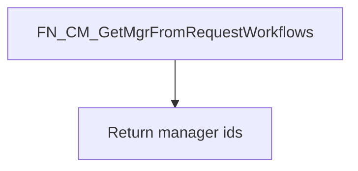

# FN_CM_GetMgrFromRequestWorkflows

## What it does

Returns a comma-separated list of manager ids from TRequestWorkflows for one transaction, request type, and approval status.

## Parameters

| Name | Direction | What it is for |
|---|---|---|
| `@TransId` | in | Request transaction id |
| `@RequestType` | in | Request type |
| `@ApproveStatus` | in | Approval status to match |

## Call sequence

Calls no other procedures or functions.

## Callers

Procedures and functions that call this object.

| Object | Kind | Page |
|---|---|---|
| `SP_AddCompOffRequest` | procedure | No page yet |
| `SP_AddCompOffRequest_Mobile` | procedure | No page yet |
| `SP_AdminLM_UpdNewLeaveType` | procedure | No page yet |
| `SP_AdminMstr_UpdEmploymentType` | procedure | No page yet |
| `SP_AdminRM_InsDocTemplatesNew` | procedure | No page yet |
| `SP_AdminWM_UpdateRoles` | procedure | No page yet |
| `SP_CM_ApproveAdminChangesRequest` | procedure | No page yet |
| `SP_CM_ApproveWorkFlowRequest` | procedure | No page yet |
| `SP_CM_ApproveWorkFlowRequest_240624` | procedure | No page yet |
| `SP_CM_ApproveWorkFlowRequest_test` | procedure | No page yet |
| `SP_CM_ApproveWorkFlowRequestBKP03052025` | procedure | No page yet |
| `SP_CM_ApproveWorkFlowRequestbkp21032024` | procedure | No page yet |
| `SP_CM_RejectWorkFlowRequest` | procedure | No page yet |
| `SP_CM_RejectWorkFlowRequestBKP03052025` | procedure | No page yet |
| `SP_deleteEmpDocGeneratedDetailsNew` | procedure | No page yet |
| `SP_DeleteRRSDocTemplateByDocIdNew` | procedure | No page yet |
| `SP_ESS_InsertBusinessCardDetails` | procedure | No page yet |
| `SP_InsertEmpDocGeneratedDetailsNew` | procedure | [SP_InsertEmpDocGeneratedDetailsNew](/docs/database/hrms/SP_InsertEmpDocGeneratedDetailsNew) |
| `SP_LA_AddAttendanceRegularisationDetails` | procedure | No page yet |
| `SP_LA_AddWorkFromHomeRequestDetails` | procedure | No page yet |
| `SP_LA_InsertLeaveRequestDetails` | procedure | No page yet |
| `SP_LA_InsertLeaveRequestDetails_dp` | procedure | No page yet |
| `SP_LA_InsertOptionalHoliday` | procedure | No page yet |
| `SP_LA_LeaveCancellation` | procedure | No page yet |
| `SP_LA_OptionalHolidayCancellation` | procedure | No page yet |
| `SP_LA_UpdateARPullBack` | procedure | No page yet |
| `SP_LA_UpdateLeavePullBack` | procedure | No page yet |
| `SP_LA_UpdateOptionalHolidayPullBack` | procedure | No page yet |
| `SP_LA_UpdateWFHPullBack` | procedure | No page yet |
| `SP_PullbackCompOffRequestByEmployee` | procedure | No page yet |
| `SP_PullbackRequest` | procedure | No page yet |
| `Sp_RRS_CloseRRS` | procedure | No page yet |
| `Sp_RRS_DeleteDetails` | procedure | No page yet |
| `Sp_RRS_InsertDetails` | procedure | No page yet |
| `Sp_RRS_UpdateDetails` | procedure | No page yet |
| `Sp_RRS_UpdateInitiateHiring` | procedure | No page yet |
| `SP_SEP_AddResignationDetails` | procedure | No page yet |
| `SP_SEP_ResignationPullback` | procedure | No page yet |
| `USP_Admin_DeleteDocTemplateByDocId` | procedure | No page yet |
| `USP_Admin_InsDocTemplates` | procedure | No page yet |
| `USP_AttendanceOverTime_Process` | procedure | No page yet |
| `USP_ClaimEventLeave_Pullback` | procedure | No page yet |
| `USP_ClaimEventLeave_Pullback_Reject` | procedure | No page yet |
| `USP_ClaimEventLeave_SaveRequest` | procedure | No page yet |
| `USP_ClaimLocum_PullBack` | procedure | No page yet |
| `USP_ClaimLocum_SaveUpdate` | procedure | No page yet |
| `USP_ClaimOT_ProcessPendingRequests` | procedure | No page yet |
| `USP_ClaimOT_SaveUpdate` | procedure | No page yet |
| `USP_ClaimPH_PullBack` | procedure | No page yet |
| `USP_ClaimPH_SaveUpdate` | procedure | No page yet |
| `USP_CompOff_PullbackRequestByEmployee` | procedure | No page yet |
| `USP_CompOff_SaveRequest` | procedure | No page yet |
| `USP_FNF_Employee_SaveUpdate` | procedure | No page yet |
| `USP_LA_InsertLeaveRequestDetails` | procedure | No page yet |
| `USP_LE_Encashment_Save` | procedure | No page yet |
| `USP_OH_PullbackRequest` | procedure | No page yet |
| `USP_OH_SaveRequest` | procedure | No page yet |
| `USP_OT_Claim_Manual` | procedure | No page yet |
| `USP_OT_Claim_Process` | procedure | No page yet |
| `USP_OT_Deviation_Save` | procedure | No page yet |
| `USP_OT_OTRequest_SaveDeviation` | procedure | No page yet |
| `USP_OT_OTRequest_SaveUpdate` | procedure | No page yet |
| `USP_OT_Planned_SaveUpdate` | procedure | No page yet |
| `USP_WFH_PullbackRequest` | procedure | No page yet |
| `USP_WFH_SaveRequest` | procedure | No page yet |

## Nested

Calls no other procedures or functions.

## Steps

1. Concatenate `Managerid` from matching `TRequestWorkflows` rows (`FN_CM_GetMgrFromRequestWorkflows.sql`).

## Tables

| Table | Read or write |
|---|---|
| `dbo.TRequestWorkflows` | read |

## Flow

