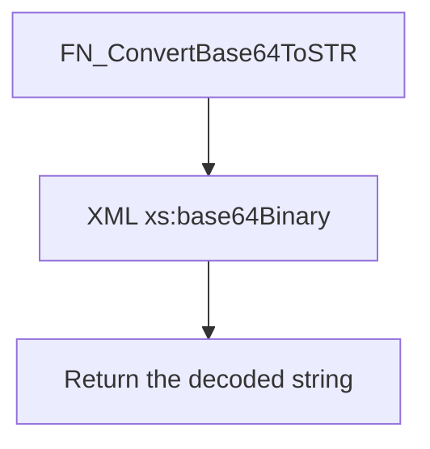

# FN_ConvertBase64ToSTR

## What it does

Decodes a Base64 string to text. It reads `xs:base64Binary` through an XML value and casts the bytes to `VARCHAR`.

## Parameters

| Name | Direction | What it is for |
|---|---|---|
| `@encodedString` | in | `VARCHAR(100)` Base64 text to decode |

## Call sequence

Calls no other procedures or functions.

## Callers

| Object | Kind | Page |
|---|---|---|
| `Fn_DecryptDataNew` | function | [Fn_DecryptDataNew](/docs/database/hrms/Fn_DecryptDataNew) |
| `SP_AddEmployerDetails` | procedure | No page yet |
| `SP_AdminORG_AddEmployerDet` | procedure | No page yet |
| `SP_AdminUM_CreateUser` | procedure | No page yet |
| `SP_AdminUM_GetActiveUserList` | procedure | No page yet |
| `Sp_AdminUM_GetAdminUsers` | procedure | No page yet |
| `SP_CheckUser` | procedure | No page yet |
| `SP_CheckUserNameAvailability` | procedure | No page yet |
| `SP_CreateUser` | procedure | No page yet |
| `SP_GetActiveUserList` | procedure | No page yet |
| `sp_GetAdminUsers` | procedure | No page yet |
| `SP_GetCustomerNo` | procedure | No page yet |
| `SP_GetEmailIdOfAdminUsers` | procedure | No page yet |
| `SP_GetParameterList` | procedure | No page yet |
| `SP_GetSMTPParameterDetails` | procedure | No page yet |
| `SP_GetUserPassword` | procedure | No page yet |
| `SP_IsValidUserName` | procedure | No page yet |
| `SP_LOG_CheckUser` | procedure | No page yet |
| `SP_LOG_CheckUser_ExternalLogin` | procedure | No page yet |
| `SP_LOG_IsValidUserName` | procedure | No page yet |
| `SP_LOG_UserEmployee` | procedure | No page yet |
| `SP_UserEmployee` | procedure | No page yet |
| `USP_GetParameterDetails` | procedure | No page yet |
| `USP_IsEmployeeAllowToAdd` | procedure | No page yet |
| `USP_IsMultipleOrganizationAllow` | procedure | No page yet |
| `usp_vw_RetirementReminder` | procedure | No page yet |
| `usp_VW_UserCreation` | procedure | No page yet |

## Nested

Calls no other procedures or functions.

## Steps

In `HRMS-DATABASE/HRMS/FUNCTIONS/FN_ConvertBase64ToSTR.sql`:

1. Select `xs:base64Binary(sql:variable("@encodedString"))` from `CAST(N'' AS XML).value`, cast the `VARBINARY(MAX)` result to `VARCHAR(MAX)`, and store it in `@decodedString`.
2. Return `@decodedString`. The declared return type is `VARCHAR(100)`.

## Tables

| Table | Read or write |
|---|---|
| — | The function does not read or write a table |

## Flow

