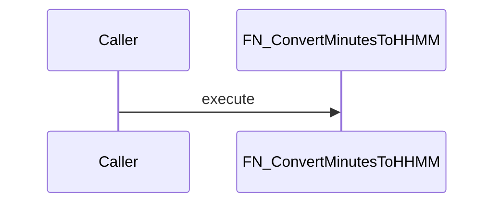
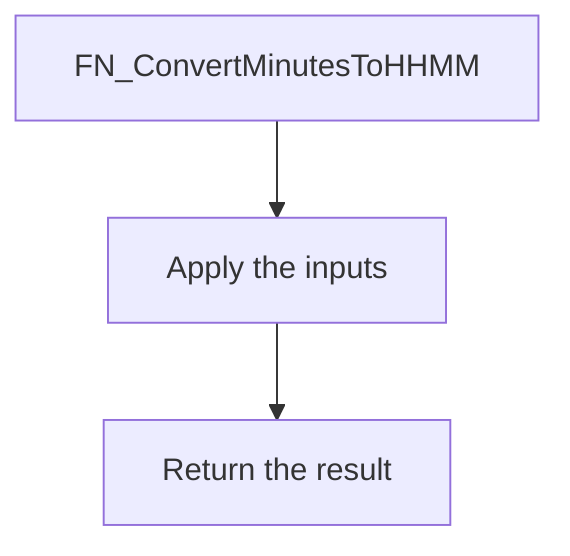

# FN_ConvertMinutesToHHMM

## What it does

Helper called by a Home dashboard procedure. It reads its inputs and returns that result to its caller.

## Parameters

| Name | Direction | What it is for |
|---|---|---|
| `@Minutes` | in | Input used by this procedure (`Int`) |

## Call sequence

## Callers

| Object | Kind | Page |
|---|---|---|
| `FN_EmployeeActualHours` | function | No page yet |
| `FN_GetAttendanceBasedOnConfiguration` | function | No page yet |
| `FN_GetAttendanceBasedOnGracePeriod` | function | No page yet |
| `FN_TotalHoursWorked` | function | No page yet |
| `Hrms_Sp_DailyAttendanceReport` | procedure | No page yet |
| `Hrms_Sp_DailyAttendanceReport_DP` | procedure | No page yet |
| `SP_AverageActualWorkHoursDetailed` | procedure | No page yet |
| `SP_AverageActualWorkHoursSummary` | procedure | No page yet |
| `SP_DB_EmployeeAttendanceDetails` | procedure | [SP_DB_EmployeeAttendanceDetails](/docs/database/hrms/SP_DB_EmployeeAttendanceDetails) |
| `SP_DB_EmployeeAttendanceDetails_HT` | procedure | No page yet |
| `SP_DB_EmployeeAttendanceFromEmailDetails` | procedure | No page yet |
| `SP_DB_EmployeeDayWiseAttendanceDetails` | procedure | No page yet |
| `SP_GetAttendance` | procedure | No page yet |
| `Sp_GetAttendanceDateWise` | procedure | No page yet |
| `SP_GetCheckinCheckoutTimeForAllEmployee` | procedure | No page yet |
| `SP_GetDashboardAttendanceDetails` | procedure | No page yet |
| `SP_GetDataForEmailNotIfication` | procedure | No page yet |
| `SP_GetDataForEmailNotIfication_Backup_2Sept25` | procedure | No page yet |
| `SP_GetDataForEmailNotIfication_newbkp` | procedure | No page yet |
| `Sp_GetEmpAttendanceDetails` | procedure | No page yet |
| `Sp_GetEmpAttendanceDetails_DashBoard` | procedure | No page yet |
| `Sp_GetEmpAttendanceDetailsScheduler` | procedure | No page yet |
| `SP_GetHomePageDetails1` | procedure | No page yet |
| `SP_GetHomePageTimeDetails` | procedure | No page yet |
| `SP_GetHomePageTimeDetails_latest` | procedure | No page yet |
| `SP_GetTeamAttendanceDetails` | procedure | No page yet |
| `SP_GetTeamAttendanceDetailsNew` | procedure | [SP_GetTeamAttendanceDetailsNew](/docs/database/hrms/SP_GetTeamAttendanceDetailsNew) |
| `SP_LA_GetAttendanceForApproveLeaveAndWFH` | procedure | No page yet |
| `SP_LA_ValidateDayBasedARRequest` | procedure | No page yet |
| `Sp_TS_ExportEmpTimeSheetReportByWeeklyMonthly` | procedure | No page yet |
| `Sp_TS_GetEmpProjectDetails` | procedure | No page yet |
| `Sp_TS_GetEmpTimeSeetAttendanceDetails` | procedure | No page yet |
| `Sp_TS_GetEmpTimeSheetReportByDWM` | procedure | No page yet |
| `Sp_TS_GetEmpTimeSheetReportByDWM_adrtest` | procedure | No page yet |
| `Sp_TS_GetEmpTimeSheetReportByDWM_HT` | procedure | No page yet |
| `Sp_TS_GetEmpTimeSheetRpt` | procedure | No page yet |
| `Sp_TS_GetTimeSheetChart` | procedure | No page yet |
| `Sp_TS_GetTimeSheetDetails` | procedure | No page yet |
| `Sp_TS_GetTimeSheetDetails_ClickTime` | procedure | No page yet |
| `Sp_TS_GetTimeSheetDetails_HT` | procedure | No page yet |
| `sp_vw_AttendanceRegularizationSummaryReports` | procedure | No page yet |
| `SP_vw_LeaveSummaryReports` | procedure | No page yet |
| `UFN_GetAttendanceBasedOnConfiguration_DRN` | function | No page yet |
| `usp_Forgotcheckoutdetailed` | procedure | No page yet |
| `usp_Forgotcheckoutdetails` | procedure | No page yet |
| `USP_Get_AttendanceReportForIASYS` | procedure | No page yet |
| `usp_GetDataForEmailNotIfication` | procedure | No page yet |
| `USp_GetEmpAttendanceDetails_CLPRD` | procedure | No page yet |
| `USp_GetEmpAttendanceDetails_V2` | procedure | No page yet |
| `USP_GetEmployeeLeaveAttendanceDetails_HT` | procedure | No page yet |
| `USP_LA_Approved_All_AR_Cancellation` | procedure | No page yet |
| `USP_LA_Approved_All_AR_Request` | procedure | No page yet |
| `USP_Report_Leave_LeaveRange` | procedure | No page yet |
| `USP_Report_Leave_LeaveSummary` | procedure | No page yet |
| `USP_Report_Leave_PendingApprovals` | procedure | No page yet |
| `USP_SSRS_RPT_AverageActualWorkHoursDetailed` | procedure | No page yet |
| `USP_SSRS_RPT_AverageActualWorkHoursSummary` | procedure | No page yet |
| `USP_SSRS_RPT_Forgotcheckoutdetailed` | procedure | No page yet |
| `USP_SSRS_RPT_Forgotcheckoutdetails` | procedure | No page yet |
| `USP_SSRS_RPT_GetAttendanceRegularizationTimeDetailed` | procedure | No page yet |
| `USP_SSRS_RPT_GetAttendanceRegularizationTimeSummary` | procedure | No page yet |
| `USP_SSRS_RPT_GetLocationWiseARDetails` | procedure | No page yet |
| `USP_TS_GetEmpTimeSheetReportByDateRange` | procedure | No page yet |
| `usp_vw_AttendanceRegularization` | procedure | No page yet |

## Nested

This object does not execute another procedure or user-defined function.

## Steps

In `HRMS-DATABASE/HRMS/FUNCTIONS/FN_ConvertMinutesToHHMM.sql`:

1. Return the result set to the caller.

## Tables

No permanent table is read or written. The result comes from parameters, functions, or table variables.

## Flow

