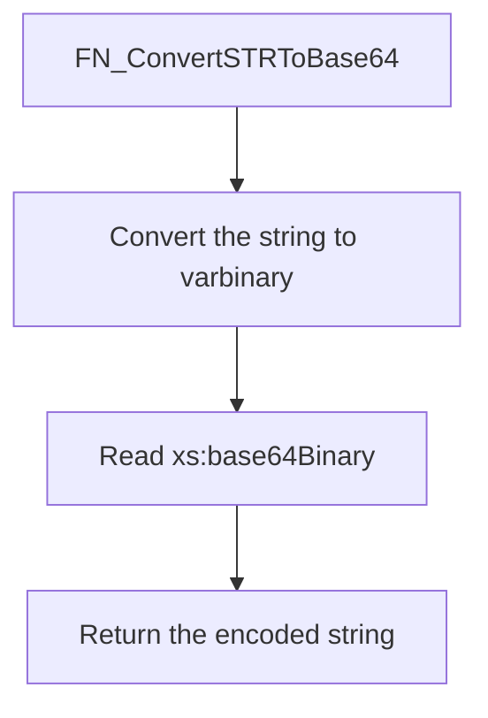

# FN_ConvertSTRToBase64

## What it does

Encodes a string as Base64. It converts the input to `VARBINARY`, then reads `xs:base64Binary` through an XML value. It returns that encoded string.

## Parameters

| Name | Direction | What it is for |
|---|---|---|
| `@decodedString` | in | `VARCHAR(MAX)` text to encode |

## Call sequence

Calls no other procedures or functions.

## Callers

| Object | Kind | Page |
|---|---|---|
| `Fn_EncryptDataNew` | function | No page yet |
| `Sp_AdminEMP_CopyEmployee` | procedure | No page yet |
| `SP_Bulk_AddNewEmployee` | procedure | No page yet |
| `sp_CopyEmployee` | procedure | No page yet |
| `SP_EC_AddNewEmployee` | procedure | No page yet |
| `SP_EC_AddNewEmployeeImport` | procedure | No page yet |
| `SP_EC_UpdateEmployeePersonalInformation` | procedure | No page yet |
| `SP_GetPendingLeaveApplications` | procedure | No page yet |
| `SP_GetRolesForControllerAction` | procedure | No page yet |
| `SP_GetRolesForControllerActionByEmail` | procedure | No page yet |
| `SP_GetUserPasswordHistory` | procedure | No page yet |
| `SP_Import_Employee_data` | procedure | No page yet |
| `SP_Import_Employee_data_Fiji` | procedure | No page yet |
| `SP_InsUpdatePOBCandidateLogin` | procedure | No page yet |
| `SP_Mydetails_Enhanced_UpdateEmployeePersonalInformation` | procedure | [SP_Mydetails_Enhanced_UpdateEmployeePersonalInformation](/docs/database/hrms/SP_Mydetails_Enhanced_UpdateEmployeePersonalInformation) |
| `SP_UpdCustomerConfig_EmploymentNumber` | procedure | No page yet |
| `USP_COB_ProcessTEmployeeInfo` | procedure | No page yet |
| `USP_InsUpdatePOCandidateInitiateLogin` | procedure | No page yet |
| `USP_UpdateParameter` | procedure | No page yet |
| `uspProcessTEmployeeInfo_New` | procedure | No page yet |

## Nested

Calls no other procedures or functions.

## Steps

In `HRMS-DATABASE/HRMS/FUNCTIONS/FN_ConvertSTRToBase64.sql`:

1. Convert `@decodedString` to `VARBINARY(MAX)`.
2. Select `xs:base64Binary(xs:hexBinary(...))` from `cast(N'' AS XML).value` into `@encodedString`.
3. Return `@encodedString`.

## Tables

| Table | Read or write |
|---|---|
| — | The function does not read or write a table |

## Flow

