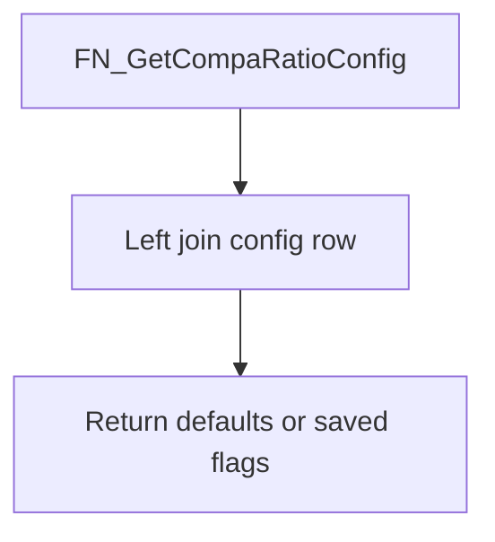

# FN_GetCompaRatioConfig

## What it does

Inline table-valued function that returns one logical config row for an employer. When `TCompensationCompaRatioConfig` has no row, it still returns defaults: Designation and Experience Band on, optional toggles off, Min skills 2, Min sample size 2, and SalaryBasis Total Amount (Fixed + Variable). Skill Experience is on only when both Skills and Skill Experience flags are on.

## Parameters

| Name | Direction | What it is for |
|---|---|---|
| `@EmployerId` | in | Organisation whose config (or defaults) is returned |

## Call sequence

Calls no other procedures or functions.

## Callers

Procedures and functions that call this object.

| Object | Kind | Page |
|---|---|---|
| `SP_GetCompaRatioConfig` | procedure | [SP_GetCompaRatioConfig](/docs/database/hrms/SP_GetCompaRatioConfig) |
| `SP_GetCompaRatioRecalculationCount` | procedure | [SP_GetCompaRatioRecalculationCount](/docs/database/hrms/SP_GetCompaRatioRecalculationCount) |
| `SP_InsertUpdateCompaRatioConfig` | procedure | [SP_InsertUpdateCompaRatioConfig](/docs/database/hrms/SP_InsertUpdateCompaRatioConfig) |
| `SP_GetCompaRatioFilterOptions` | procedure | No page yet |
| `SP_GetCompensationReport` | procedure | No page yet |
| `SP_GetSalaryBenchmarking` | procedure | No page yet |
| `SP_GetSalaryBenchmarkingEmployeeDetails` | procedure | No page yet |
| `SP_InsertUpdateEmployeeSalaryStructureCompaRatioBatch` | procedure | No page yet |

## Nested

Calls no other procedures or functions.

## Steps

1. Left join `TCompensationCompaRatioConfig` on `@EmployerId` from a one-row driver (`FUNCTIONS/FN_GetCompaRatioConfig.sql`).

2. Project IsConfigured, IsSubmitted, ConfigVersion, fixed core flags, optional toggles with ISNULL defaults, gated Skill Experience, MinSkillsToMatch, fixed MinSampleSize, and SalaryBasis.

## Tables

| Table | Read or write |
|---|---|
| `TCompensationCompaRatioConfig` | read |

## Flow

