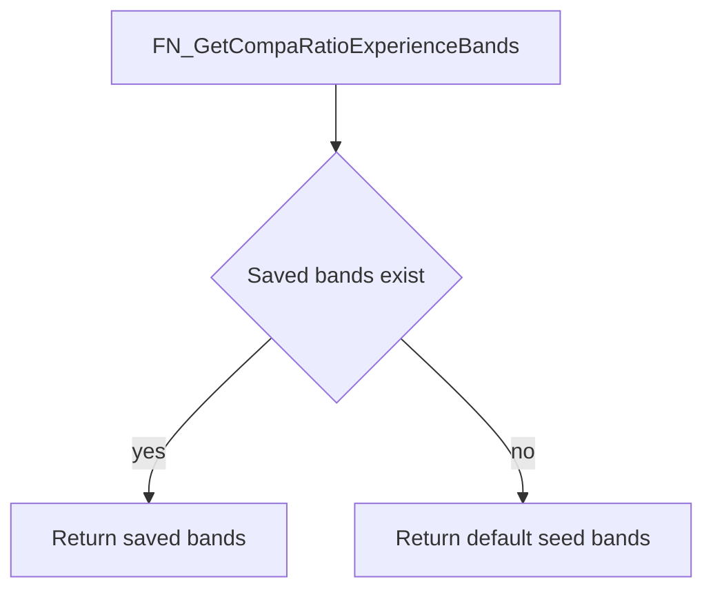

# FN_GetCompaRatioExperienceBands

## What it does

Inline table-valued function that returns the Experience (`EXP`) or Skill Experience (`SKILLEXP`) band master for an employer. If the employer has no saved rows for that BandType, it returns the matching seed rows from `TCompensationExperienceBandDefault` with `IsDefault = 1`.

## Parameters

| Name | Direction | What it is for |
|---|---|---|
| `@EmployerId` | in | Organisation whose bands are resolved |
| `@BandType` | in | `EXP` or `SKILLEXP` |

## Call sequence

Calls no other procedures or functions.

## Callers

Procedures and functions that call this object.

| Object | Kind | Page |
|---|---|---|
| `SP_GetCompaRatioConfig` | procedure | [SP_GetCompaRatioConfig](/docs/database/hrms/SP_GetCompaRatioConfig) |
| `SP_InsertUpdateCompaRatioConfig` | procedure | [SP_InsertUpdateCompaRatioConfig](/docs/database/hrms/SP_InsertUpdateCompaRatioConfig) |
| `SP_GetCompaRatioFilterOptions` | procedure | No page yet |
| `SP_GetCompensationReport` | procedure | No page yet |
| `FN_GetCompaRatioEmployeePopulation` | function | No page yet |
| `FN_GetCompaRatioEmployeeSkills` | function | No page yet |

## Nested

Calls no other procedures or functions.

## Steps

1. Select saved bands from `TCompensationExperienceBand` for `@EmployerId` and `@BandType` (`FUNCTIONS/FN_GetCompaRatioExperienceBands.sql`).

2. Union default bands from `TCompensationExperienceBandDefault` only when no saved rows exist for that employer and BandType.

## Tables

| Table | Read or write |
|---|---|
| `TCompensationExperienceBand` | read |
| `TCompensationExperienceBandDefault` | read |

## Flow

