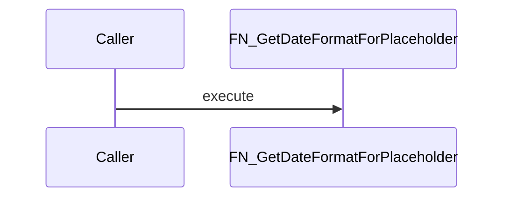
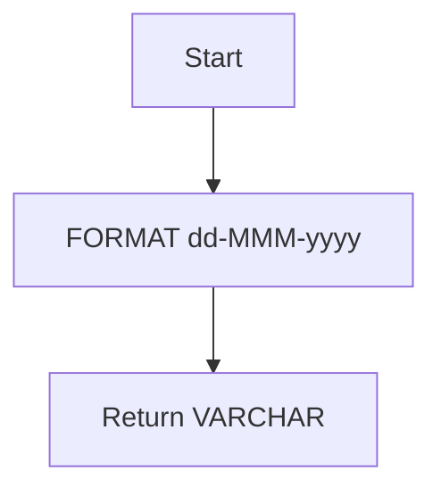

# FN_GetDateFormatForPlaceholder

## What it does

Formats a datetime as `dd-MMM-yyyy` for display placeholders (scalar string). Used by `USP_TM_TaskReport_List` for estimated and actual date columns.

## Parameters

| Name | Direction | What it is for |
|---|---|---|
| `@DateValue` | in | Date to format (`DATETIME`) |

## Call sequence

Calls no other procedures or functions.

## Callers

| Object | Kind | Page |
|---|---|---|
| `USP_TM_TaskReport_List` | procedure | [USP_TM_TaskReport_List](/docs/database/hrms/USP_TM_TaskReport_List) |

Other callers may exist outside this documentation pass.

## Nested

None.

## Steps

1. Script is `HRMS-DATABASE/HRMS/FUNCTIONS/FN_GetDateFormatForPlaceholder.sql`.
2. `FORMAT(@DateValue, 'dd-MMM-yyyy')` and return the string.

## Tables

None.

## Unresolved calls

None.

## Flow

