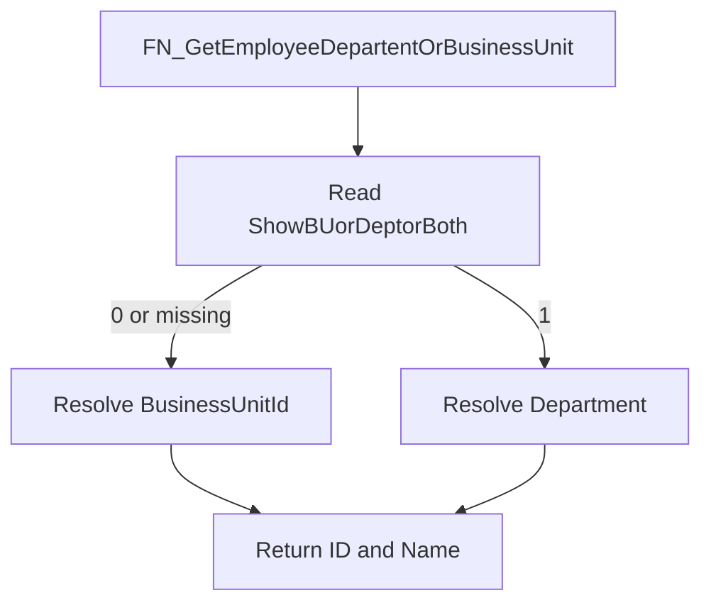

# FN_GetEmployeeDepartentOrBusinessUnit

## What it does

Table-valued function that returns one business-unit or department row for an employee. It reads `TEmployerCustomFields.ShowBUorDeptorBoth` for the employer. When that flag is `0` (or missing), it resolves the employee's `BusinessUnitId` from `TOrgHierarchyDetails`. When the flag is `1`, it resolves `TEmployeeInfo.Department` the same way. The function name keeps the historical spelling `Departent`.

## Parameters

| Name | Direction | What it is for |
|---|---|---|
| `@EmployeeID` | in | Employee whose org unit is resolved |
| `@EmployerID` | in | Employer that owns the custom-field flag and hierarchy rows |

## Call sequence

Calls no other procedures or functions.

## Callers

| Object | Kind | Page |
|---|---|---|
| `SP_AdminPMS_EmployeeSearch` | procedure | [SP_AdminPMS_EmployeeSearch](/docs/database/hrms/SP_AdminPMS_EmployeeSearch) |
| `SP_AdminPMS_EmployeeGoalSettingSearch` | procedure | No page yet |
| `Sp_CMS_GetConfirmationEmp` | procedure | No page yet |
| `Sp_CMS_GetConfirmationDueList` | procedure | No page yet |
| `Sp_CMS_GetNotificationListForConfirmationDueList` | procedure | No page yet |
| `Sp_CM_DirectIndirectReports` | procedure | No page yet |
| `Sp_CM_Revamp_SearchEmployee` | procedure | No page yet |
| `USP_PermissionRolesEmployeeBU_List` | procedure | No page yet |
| `SP_LOG_UserEmployee` | procedure | No page yet |
| `SP_DB_GetEmployeeProfile` | procedure | No page yet |
| `USP_WM_CHAT_GN_GetEmployeeDetailsById` | procedure | No page yet |

## Nested

Calls no other procedures or functions.

## Steps

1. Script is `HRMS-DATABASE/HRMS/FUNCTIONS/FN_GetEmployeeDepartentOrBusinessUnit.sql`.
2. Read `ShowBUorDeptorBoth` from `TEmployerCustomFields` for `@EmployerID` (default `0`).
3. From `TEmployeeInfo` for `@EmployeeID` / `@EmployerID`, outer-apply either the business-unit or department `TOrgHierarchyDetails` row based on that flag.
4. Return `@DeptBU` with `ID` and `Name`.

## Tables

| Table | Read or write |
|---|---|
| `TEmployerCustomFields` | read |
| `TEmployeeInfo` | read |
| `TOrgHierarchyDetails` | read |

## Flow

