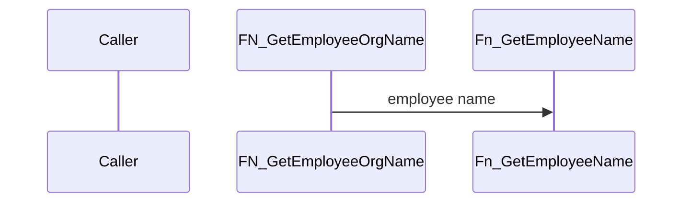
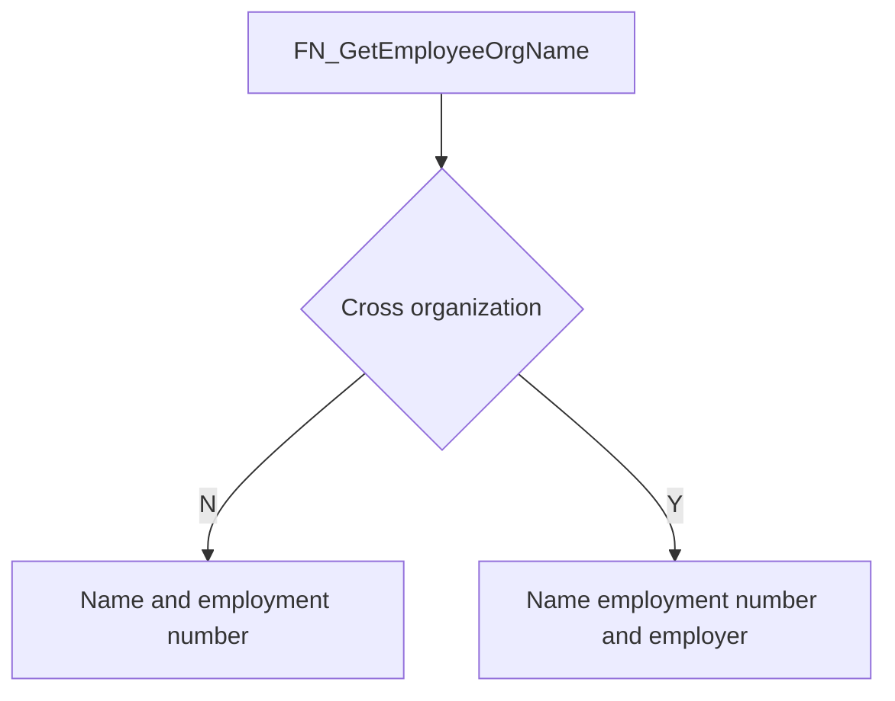

# FN_GetEmployeeOrgName

## What it does

Returns an employee label. When cross-organization reporting is off, the label is the employee name and employment number. Otherwise it also appends the employer name.

## Parameters

| Name | Direction | What it is for |
|---|---|---|
| `@IsCrossOrg` | in | Y appends the employer name. N does not |
| `@EmployeeId` | in | Employee |

## Call sequence

## Callers

Procedures and functions that call this object.

| Object | Kind | Page |
|---|---|---|
| `SP_Admin_GetAllEmployeeDetails` | procedure | No page yet |
| `SP_Admin_GetEmployeeByRoleId` | procedure | No page yet |
| `SP_AdminCMS_SrchEmpForConfReAssign` | procedure | No page yet |
| `SP_AdminEMP_EmployeeSearch` | procedure | No page yet |
| `Sp_AdminPMS_GetPendingAppList` | procedure | No page yet |
| `SP_AdminPMS_SrchEmpByAppraisalCycle` | procedure | No page yet |
| `SP_BGV_GetAllActiveEmployee` | procedure | No page yet |
| `Sp_CM_DirectIndirectReports` | procedure | No page yet |
| `SP_CM_GetAllEmployeeDetails` | procedure | No page yet |
| `SP_CM_GetEmployeeFullInformation` | procedure | No page yet |
| `SP_CM_RequestReRoute` | procedure | No page yet |
| `SP_CM_RequestReRouteBKP03052025` | procedure | No page yet |
| `Sp_CM_Revamp_SearchEmployee` | procedure | No page yet |
| `Sp_CMS_GetConfirmationDueList` | procedure | No page yet |
| `Sp_CMS_GetNotificationListForConfirmationDueList` | procedure | No page yet |
| `SP_CMSSearchEmployeeForConfirmationReAssign` | procedure | No page yet |
| `SP_Creation_Admin_GetAllEmployeeDetails` | procedure | No page yet |
| `SP_DB_GetDocumentRepositoryDetails` | procedure | No page yet |
| `Sp_DirectIndirectReports` | procedure | No page yet |
| `SP_ESS_CrossBUEmployeeAssignment` | procedure | [SP_ESS_CrossBUEmployeeAssignment](/docs/database/hrms/SP_ESS_CrossBUEmployeeAssignment) |
| `SP_ESS_CrossBUEmployeeAssignmentUserDefined` | procedure | No page yet |
| `SP_GenDocument_EmployeesList` | procedure | No page yet |
| `SP_GetAllActiveInActiveEmployeeList` | procedure | [SP_GetAllActiveInActiveEmployeeList](/docs/database/hrms/SP_GetAllActiveInActiveEmployeeList) |
| `SP_GetClearanceCategoryStatusDetails` | procedure | No page yet |
| `SP_GetClearanceStatusDetails` | procedure | No page yet |
| `Sp_GetCMSConfirmationDueList` | procedure | No page yet |
| `Sp_GetCMSEmployeeListForExtract` | procedure | No page yet |
| `SP_GetCompensationComponentMapping` | procedure | No page yet |
| `SP_GetEmployeeFullInformation` | procedure | No page yet |
| `SP_GetEmployeeSalaryStructure_History` | procedure | No page yet |
| `Sp_GetEmpSummaryRpt` | procedure | No page yet |
| `sp_GETPMSPendingAppraisalList` | procedure | No page yet |
| `Sp_GetTeamResignationStatusDetails` | procedure | No page yet |
| `Sp_LA_GetPendingActivitiesForApproval` | procedure | No page yet |
| `SP_Mydetails_Enhanced_GetEmpCurrentEmploymentFutureDetails` | procedure | No page yet |
| `SP_Mydetails_Enhanced_GetEmpCurrentEmploymentHistoryDetails` | procedure | No page yet |
| `SP_PMSSearchEmployeeByAppraisalCycle` | procedure | No page yet |
| `SP_RPT_AttendanceReport_ByDate` | procedure | No page yet |
| `SP_RPT_EmpCompetency` | procedure | No page yet |
| `SP_RPT_EmpSkillSummary` | procedure | No page yet |
| `SP_RPT_FPF_GetDisciplineRecords` | procedure | No page yet |
| `SP_RPT_GetAllEmployeeDetails` | procedure | No page yet |
| `SP_RPT_GetAllEmployeeRoleWiseDet` | procedure | No page yet |
| `SP_RPT_Leave_ByDate` | procedure | No page yet |
| `Sp_RRS_GetInterviewDataForEmail` | procedure | No page yet |
| `Sp_RRS_GetMgrListForRRS` | procedure | No page yet |
| `SP_SEP_ClearanceRequestReRoute` | procedure | No page yet |
| `SP_vw_EmplEstablishmentDetailsyeeFullInfoReports_TDG_PROD_BY_DP` | procedure | No page yet |
| `SP_vw_EmployeeFullInfoReports` | procedure | No page yet |
| `SP_vw_EmployeeFullInfoReports_dev` | procedure | No page yet |
| `UFN_Separation_GetRequestReassignReasonByID` | function | No page yet |
| `USP_ClaimEventLeave_Status_History` | procedure | No page yet |
| `USP_ClaimLocum_Status_History_ClaimLocum` | procedure | No page yet |
| `USP_ClaimPH_Status_History` | procedure | No page yet |
| `USP_CompOff_StatusHistory` | procedure | No page yet |
| `USP_EmployeeFullInfoReports` | procedure | No page yet |
| `USP_GetEmployeeAttendanceReportComplianceData` | procedure | No page yet |
| `USP_GetRequestInfo` | procedure | No page yet |
| `USP_LA_GetStatusHistory` | procedure | No page yet |
| `USP_LA_Status_History_AttendanceOverTime` | procedure | No page yet |
| `USP_LA_Status_History_AttendanceRegularize` | procedure | No page yet |
| `USP_LA_Status_History_ClaimLocum` | procedure | No page yet |
| `USP_LA_Status_History_CompOff` | procedure | No page yet |
| `USP_LA_Status_History_CompOffCreditRequest` | procedure | No page yet |
| `USP_LA_Status_History_CompOffRequest` | procedure | No page yet |
| `USP_LA_Status_History_Leave` | procedure | No page yet |
| `USP_LA_Status_History_OptionalHoliday` | procedure | No page yet |
| `USP_LA_Status_History_WorkFromHome` | procedure | No page yet |
| `USP_LA_ValidateRequestInQueue` | procedure | No page yet |
| `USP_LE_Status_History` | procedure | No page yet |
| `USP_LeaveRequest_Notification_ModalView` | procedure | No page yet |
| `Usp_Mydetails_Publicfields` | procedure | No page yet |
| `USP_OT_Claim_Status_History` | procedure | No page yet |
| `USP_OT_OTRequest_PreApprovalOT_Updates` | procedure | No page yet |
| `USP_OT_Planned_Status_History` | procedure | No page yet |
| `USP_Reassign_Execute` | procedure | No page yet |
| `USP_Reassign_GetCandidateEligibilityDetail` | procedure | No page yet |
| `USP_Reassign_GetEligibleCandidates` | procedure | No page yet |
| `USP_Reassign_Save` | procedure | No page yet |
| `USP_Report_EmployeeInfo_PassportVisaInfo` | procedure | No page yet |
| `USP_Report_EmployeeInfo_StatutoryInfo` | procedure | No page yet |
| `USP_Report_Leave_LeaveReport` | procedure | No page yet |
| `USP_Report_Recruitment_RRSFields` | procedure | No page yet |
| `Usp_SeparationClearanceReport` | procedure | No page yet |
| `USP_TerminationClearanceReport` | procedure | No page yet |
| `USP_vw_AssignedEmployeeReport` | procedure | No page yet |
| `usp_vw_RRSInitiateHiring` | procedure | No page yet |

## Nested

| Object | Kind | When | Page |
|---|---|---|---|
| `Fn_GetEmployeeName` | function | employee name | [Fn_GetEmployeeName](/docs/database/hrms/Fn_GetEmployeeName) |

## Steps

1. Read the employment number from `TEmployeeInfo` (`FN_GetEmployeeOrgName.sql`).
2. When `@IsCrossOrg` is N, return the employee name and employment number.
3. Otherwise join `TEmployerDetails` and append the employer name.

## Tables

| Table | Read or write |
|---|---|
| `dbo.TEmployeeInfo` | read |
| `dbo.TEmployee` | read |
| `dbo.TEmployerDetails` | read |

## Flow

