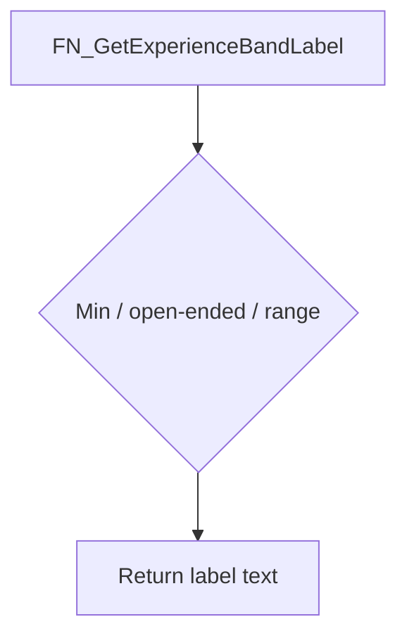

# FN_GetExperienceBandLabel

## What it does

Scalar function that builds a short experience-band label. Null MinYears becomes `New band`; open-ended or null MaxYears becomes `{Min}+ Yrs`; otherwise `{Min}–{Max} Yrs`. Marked `WITH SCHEMABINDING`.

## Parameters

| Name | Direction | What it is for |
|---|---|---|
| `@MinYears` | in | Lower bound of the band |
| `@MaxYears` | in | Upper bound; null when open-ended |
| `@IsOpenEnded` | in | When 1, format as open-ended |

## Call sequence

Calls no other procedures or functions.

## Callers

Procedures and functions that call this object.

| Object | Kind | Page |
|---|---|---|
| `SP_InsertUpdateCompaRatioConfig` | procedure | [SP_InsertUpdateCompaRatioConfig](/docs/database/hrms/SP_InsertUpdateCompaRatioConfig) |
| `FN_ValidateCompaRatioExperienceBands` | function | [FN_ValidateCompaRatioExperienceBands](/docs/database/hrms/FN_ValidateCompaRatioExperienceBands) |

## Nested

Calls no other procedures or functions.

## Steps

1. Return the CASE expression for New band / open-ended / closed range (`FUNCTIONS/FN_GetExperienceBandLabel.sql`).

## Tables

| Table | Read or write |
|---|---|
| _(none)_ | scalar only |

## Flow

