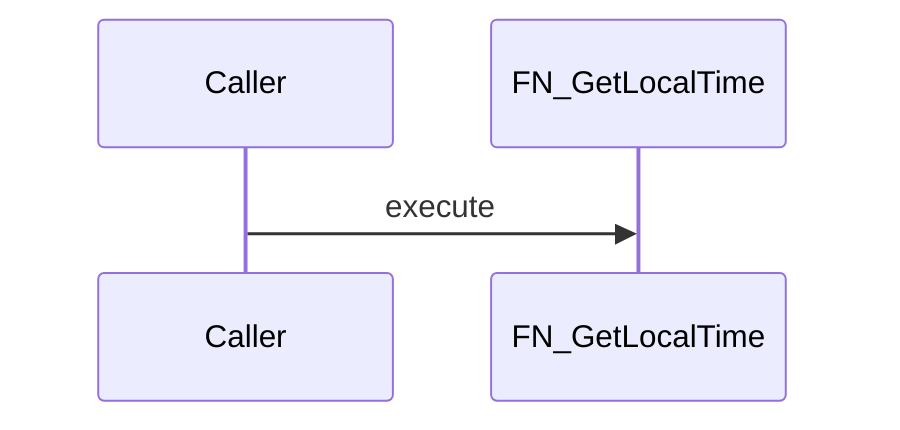
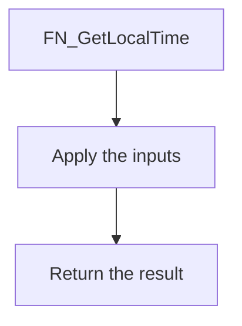

# FN_GetLocalTime

## What it does

Helper called by a Home dashboard procedure. It reads Tlocation, Temployeeinfo and returns that result to its caller.

## Parameters

| Name | Direction | What it is for |
|---|---|---|
| `@DateTimeToConvert` | in | Input used by this procedure (`DateTime`) |
| `@Employeeid` | in | Employee the Home screen is loading or acting for (`Int`) |

## Call sequence

## Callers

| Object | Kind | Page |
|---|---|---|
| `FN_EmployeeActualHours_HT` | function | No page yet |
| `FN_Get_EmployeeActualWorkedMinute` | function | [FN_Get_EmployeeActualWorkedMinute](/docs/database/hrms/FN_Get_EmployeeActualWorkedMinute) |
| `FN_Get_EmployeeTotalWorkedMinute` | function | No page yet |
| `FN_TotalHoursWorked` | function | No page yet |
| `Hrms_Sp_DailyAttendanceReport_DP` | procedure | No page yet |
| `SP_Bulk_Create_Activate_Employee` | procedure | No page yet |
| `Sp_DailyAttendanceReport_New` | procedure | No page yet |
| `SP_DB_EmployeeAttendanceDetails` | procedure | [SP_DB_EmployeeAttendanceDetails](/docs/database/hrms/SP_DB_EmployeeAttendanceDetails) |
| `SP_DB_EmployeeAttendanceDetails_HT` | procedure | No page yet |
| `SP_DB_EmployeeAttendanceFromEmailDetails` | procedure | No page yet |
| `SP_DB_EmployeeDayWiseAttendanceDetails` | procedure | No page yet |
| `SP_EC_UpdateEmployeeOfficialInformation` | procedure | No page yet |
| `SP_EC_UpdateEmployeeOfficialInformation_240624` | procedure | No page yet |
| `SP_EMPMD_GetEmpDomainHistoryDet` | procedure | No page yet |
| `SP_EMPMD_GetEmpEmergencyContHistData` | procedure | No page yet |
| `SP_EMPMD_GetEmpOFficialHistoryData` | procedure | No page yet |
| `SP_EMPMD_GetEmpPassportHistData` | procedure | No page yet |
| `SP_EMPMD_GetEmpPersonalInfoHistData` | procedure | No page yet |
| `SP_EMPMD_GetEmpSkillDet` | procedure | No page yet |
| `SP_EMPMD_GetEmpSkillHistoryDetails` | procedure | No page yet |
| `SP_EMPMD_GetEmpVISAHistoryData` | procedure | No page yet |
| `SP_Get_MyTeamCard_DirectReportees` | procedure | [SP_Get_MyTeamCard_DirectReportees](/docs/database/hrms/SP_Get_MyTeamCard_DirectReportees) |
| `SP_Get_MyTeamCard_InDirectReportees` | procedure | [SP_Get_MyTeamCard_InDirectReportees](/docs/database/hrms/SP_Get_MyTeamCard_InDirectReportees) |
| `SP_GetAttendance` | procedure | No page yet |
| `SP_GetAttendancetransaction` | procedure | No page yet |
| `SP_GetDashboardAttendanceDetails` | procedure | No page yet |
| `SP_GetDataForEmailNotIfication` | procedure | No page yet |
| `SP_GetDataForEmailNotIfication_Backup_2Sept25` | procedure | No page yet |
| `SP_GetDataForEmailNotIfication_newbkp` | procedure | No page yet |
| `SP_GetEmpDomainHistoryDetails` | procedure | No page yet |
| `SP_GetEmployeeEmergencyContactHistoryData` | procedure | No page yet |
| `SP_GetEmployeeOFficialHistoryData` | procedure | No page yet |
| `SP_GetEmployeePassportHistoryData` | procedure | No page yet |
| `SP_GetEmployeePersonalInfoHistoryData` | procedure | No page yet |
| `SP_GetEmployeeSkillDetails` | procedure | No page yet |
| `SP_GetEmployeeVISAHistoryData` | procedure | No page yet |
| `SP_GetEmpSkillHistoryDetails` | procedure | No page yet |
| `SP_GetHomePageTimeDetails` | procedure | No page yet |
| `SP_GetHomePageTimeDetails_latest` | procedure | No page yet |
| `SP_GetPunchedInTime` | procedure | No page yet |
| `SP_GetTeamAttendanceDetailsNew` | procedure | [SP_GetTeamAttendanceDetailsNew](/docs/database/hrms/SP_GetTeamAttendanceDetailsNew) |
| `SP_GetTempLocationLog` | procedure | No page yet |
| `SP_LA_GetAttendanceForApproveLeaveAndWFH` | procedure | No page yet |
| `Sp_TS_GetEmpProjectDetails` | procedure | No page yet |
| `Sp_TS_GetEmpTimeSeetAttendanceDetails` | procedure | No page yet |
| `SP_UpdateDailyRegisterNew_HT` | procedure | No page yet |
| `UFN_CalCulateEmployeeTotalCapacityProject` | function | [UFN_CalCulateEmployeeTotalCapacityProject](/docs/database/hrm-timeport/UFN_CalCulateEmployeeTotalCapacityProject) |
| `ufn_CalculateTotalCapacity` | function | No page yet |
| `UFN_Check_InValidInOutExists` | function | No page yet |
| `USP_AddForceTimeOut` | procedure | No page yet |
| `USP_CalculateDailyAttendance` | procedure | No page yet |
| `USP_Employee_ActualWorkedLeaveHours` | procedure | No page yet |
| `USP_EmployeeTotalCapacity` | procedure | No page yet |
| `USP_EmployeeTotalCapacityByProject` | procedure | No page yet |
| `USP_EmployeeTotalCapacityByProject_Chart` | procedure | No page yet |
| `USP_GET_AllConversationDetailsByUser` | procedure | No page yet |
| `USP_Get_AttendanceReportForIASYS` | procedure | No page yet |
| `USP_Get_Employees_ActualWorkedMinutesLeaves` | procedure | No page yet |
| `usp_GetDataForEmailNotIfication` | procedure | No page yet |
| `USP_GetEmployeeLeaveAttendanceDetails` | procedure | No page yet |
| `usp_vw_AttendanceRegularization` | procedure | No page yet |

## Nested

This object does not execute another procedure or user-defined function.

## Steps

In `HRMS-DATABASE/HRMS/FUNCTIONS/FN_GetLocalTime.sql`:

1. Read `Tlocation`, `Temployeeinfo`.
2. Return the result set to the caller.

## Tables

| Table | Read or write |
|---|---|
| `Tlocation` | read |
| `Temployeeinfo` | read |

## Flow

