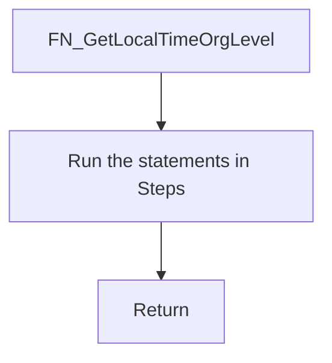

# FN_GetLocalTimeOrgLevel

## What it does

Converts a datetime to the employer time zone using AT TIME ZONE and returns it as a datetime.

## Parameters

| Name | Direction | What it is for |
|---|---|---|
| `@DateTimeToConvert` | in | Timestamp to convert |
| `@EmployerId` | in | Employer whose TimeZoneId is used. Default null |

## Call sequence

Calls no other procedures or functions.

## Callers

| Object | Kind | Page |
|---|---|---|
| `SP_AdminMstr_GetNewsAndEvents` | procedure | No page yet |
| `SP_AdminRoleM_GetEmpSumPermissionMapHist` | procedure | [SP_AdminRoleM_GetEmpSumPermissionMapHist](/docs/database/hrms/SP_AdminRoleM_GetEmpSumPermissionMapHist) |
| `Sp_AdminRoleM_GetRolePageMapHistByTransid` | procedure | [Sp_AdminRoleM_GetRolePageMapHistByTransid](/docs/database/hrms/Sp_AdminRoleM_GetRolePageMapHistByTransid) |
| `Sp_AdminRoleM_GetUserPageMapHistByid` | procedure | No page yet |
| `SP_GetEmpSummaryPermissionMappingHistory` | procedure | No page yet |
| `SP_GetNewsAndEvents` | procedure | No page yet |
| `sp_getRolePageMappingHistoryByTransid` | procedure | No page yet |
| `sp_GetUserPageMappingHistoryByUserid` | procedure | No page yet |
| `SP_InsertAttendanceData` | procedure | No page yet |
| `SP_InsertAttendanceDataWithMachineID` | procedure | No page yet |
| `USP_ProcessAttendancePunchUpload` | procedure | No page yet |
| `USP_ValidateAttendancePunchUploadRequest` | procedure | No page yet |

## Nested

Calls no other procedures or functions.

## Steps

1. Read TimeZoneId from Temployerdetails.
2. Cast the input as datetimeoffset at that time zone and return it as datetime.

## Tables

| Table | Read or write |
|---|---|
| `Temployerdetails` | read |

## Flow

