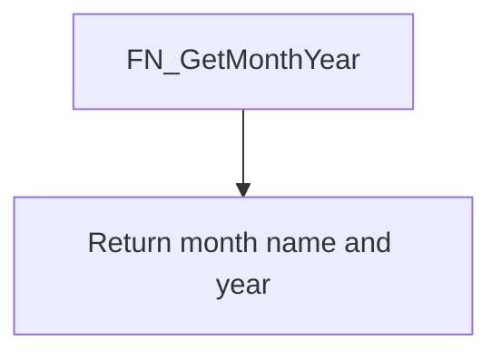

# FN_GetMonthYear

## What it does

Turns a year-month string such as 202611 into a label such as November, 2026 by appending 01 and reading the month name and year.

## Parameters

| Name | Direction | What it is for |
|---|---|---|
| `@YearMonth` | in | Year and month digits |

## Call sequence

Calls no other procedures or functions.

## Callers

Procedures and functions that call this object.

| Object | Kind | Page |
|---|---|---|
| `SP_AdminESS_GetVoucherAppEmpList` | procedure | [SP_AdminESS_GetVoucherAppEmpList](/docs/database/hrms/SP_AdminESS_GetVoucherAppEmpList) |
| `SP_AdminESS_GetVouchers` | procedure | [SP_AdminESS_GetVouchers](/docs/database/hrms/SP_AdminESS_GetVouchers) |
| `SP_EmployeeSelfService_VoucherRequestStatus` | procedure | No page yet |
| `SP_EmployeeSelfService_VoucherRequestStatus_GlobalFilter` | procedure | No page yet |
| `SP_ESS_GetVoucherNotification` | procedure | No page yet |
| `SP_ESS_GetVoucherRequestStatus` | procedure | No page yet |
| `SP_GetVoucherAppliedEmpList` | procedure | No page yet |
| `SP_GetVoucherNotification` | procedure | No page yet |
| `SP_GetVoucherRequestStatus` | procedure | No page yet |
| `SP_GetVouchers` | procedure | No page yet |
| `USP_Report_EmployeeInfo_BenefitVouchers` | procedure | No page yet |
| `usp_Vw_VoucherApplied` | procedure | No page yet |
| `usp_Vw_VoucherClosure` | procedure | No page yet |
| `usp_Vw_VoucherInitiation` | procedure | No page yet |

## Nested

Calls no other procedures or functions.

## Steps

1. Append 01, cast to a date, and return the month name plus the year (`FN_GetMonthYear.sql`).

## Tables

No table is read or written.

## Flow

