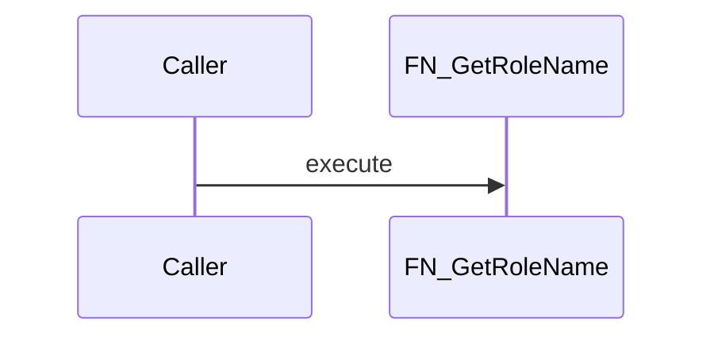
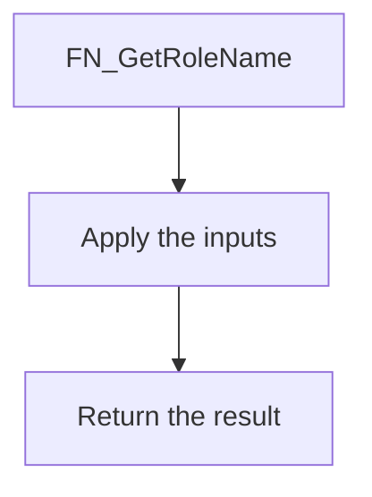

# FN_GetRoleName

## What it does

Helper called by a Home dashboard procedure. It reads tRoles and returns that result to its caller.

## Parameters

| Name | Direction | What it is for |
|---|---|---|
| `@RoleId` | in | Role whose tab grants are loaded (`INT`) |
| `@EmployerId` | in | Employer that owns the data (`INT`) |

## Call sequence

## Callers

| Object | Kind | Page |
|---|---|---|
| `Sp_CM_DirectIndirectReports` | procedure | No page yet |
| `Sp_CM_Mydetails_DirectIndirectReports` | procedure | No page yet |
| `Sp_CM_Mydetails_DirectIndirectReports_Count` | procedure | No page yet |
| `SP_GetHomePageNotificationCnt` | procedure | No page yet |
| `SP_GetPartialEmployeeDet` | procedure | No page yet |
| `SP_GetTeamAttendanceDetailsNew` | procedure | [SP_GetTeamAttendanceDetailsNew](/docs/database/hrms/SP_GetTeamAttendanceDetailsNew) |
| `SP_PMS_GetConfirmationAsessment` | procedure | No page yet |
| `USP_Client_List` | procedure | No page yet |

## Nested

This object does not execute another procedure or user-defined function.

## Steps

In `HRMS-DATABASE/HRMS/FUNCTIONS/FN_GetRoleName.sql`:

1. Read `tRoles`.
2. Return the result set to the caller.

## Tables

| Table | Read or write |
|---|---|
| `tRoles` | read |

## Flow

