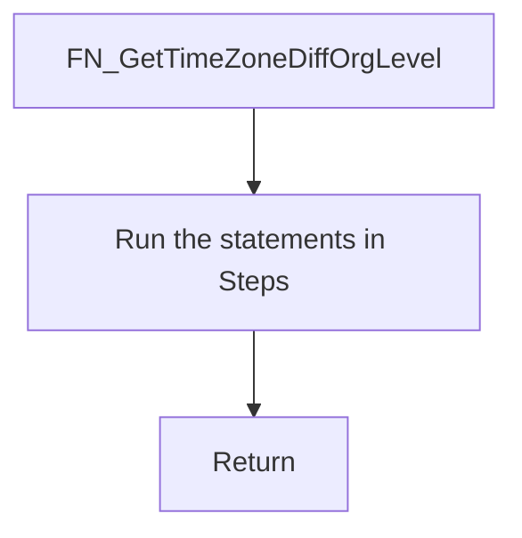

# FN_GetTimeZoneDiffOrgLevel

## What it does

Returns Y when the employer time zone id differs from the Windows time zone of the SQL Server machine, and N when they match or the employer has no time zone.

## Parameters

| Name | Direction | What it is for |
|---|---|---|
| `@EmployerId` | in | Employer whose TimezoneId is compared |

## Call sequence

Calls no other procedures or functions.

## Callers

| Object | Kind | Page |
|---|---|---|
| `SP_AdminMstr_GetNewsAndEvents` | procedure | No page yet |
| `SP_AdminRoleM_GetEmpSumPermissionMapHist` | procedure | [SP_AdminRoleM_GetEmpSumPermissionMapHist](/docs/database/hrms/SP_AdminRoleM_GetEmpSumPermissionMapHist) |
| `Sp_AdminRoleM_GetRolePageMapHistByTransid` | procedure | [Sp_AdminRoleM_GetRolePageMapHistByTransid](/docs/database/hrms/Sp_AdminRoleM_GetRolePageMapHistByTransid) |
| `Sp_AdminRoleM_GetUserPageMapHistByid` | procedure | No page yet |
| `SP_GetEmpSummaryPermissionMappingHistory` | procedure | No page yet |
| `SP_GetNewsAndEvents` | procedure | No page yet |
| `sp_getRolePageMappingHistoryByTransid` | procedure | No page yet |
| `sp_GetUserPageMappingHistoryByUserid` | procedure | No page yet |

## Nested

Calls no other procedures or functions.

## Steps

1. Read TimeZoneKeyName from the machine registry.
2. Read TimezoneId from Temployerdetails.
3. Return Y when they differ and N when they are the same.

## Tables

| Table | Read or write |
|---|---|
| `Temployerdetails` | read |

## Flow

