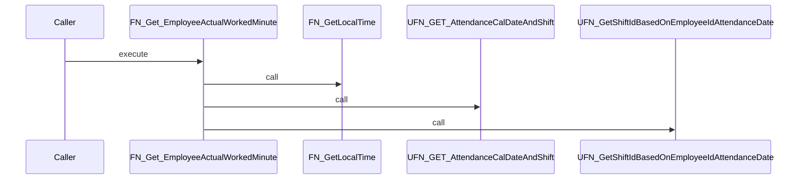
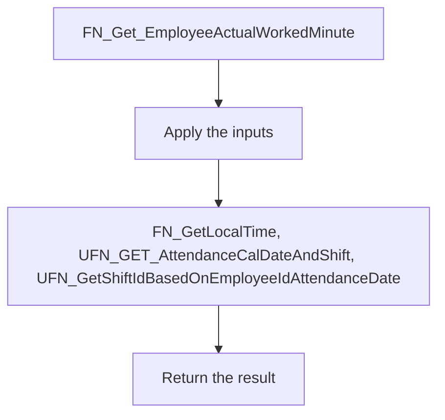

# FN_Get_EmployeeActualWorkedMinute

## What it does

Helper called by a Home dashboard procedure. It reads and writes T, TSHIFTMASTER, TShiftAttendanceConfig, TShiftAttendanceConfig_History and returns that result to its caller.

## Parameters

| Name | Direction | What it is for |
|---|---|---|
| `@AttendanceDate` | in | Input used by this procedure (`DATETIME`) |
| `@EmployeeId` | in | Employee the Home screen is loading or acting for (`INT`) |

## Call sequence

## Callers

| Object | Kind | Page |
|---|---|---|
| `FN_EmployeeActualHours` | function | No page yet |
| `SP_GetAttendance` | procedure | No page yet |
| `SP_GetDashboardAttendanceDetails` | procedure | No page yet |
| `SP_GetHomePageTimeDetails` | procedure | No page yet |
| `SP_GetHomePageTimeDetails_latest` | procedure | No page yet |
| `SP_GetTeamAttendanceDetailsNew` | procedure | [SP_GetTeamAttendanceDetailsNew](/docs/database/hrms/SP_GetTeamAttendanceDetailsNew) |
| `SP_LeaveAttendance_DashBoard` | procedure | No page yet |
| `USP_CalculateDailyAttendance` | procedure | No page yet |

## Nested

| Object | Kind | When | Page |
|---|---|---|---|
| `FN_GetLocalTime` | function | Called while this object runs | [FN_GetLocalTime](/docs/database/hrms/FN_GetLocalTime) |
| `UFN_GET_AttendanceCalDateAndShift` | function | Called while this object runs | No page yet |
| `UFN_GetShiftIdBasedOnEmployeeIdAttendanceDate` | function | Called while this object runs | No page yet |

## Steps

In `HRMS-DATABASE/HRMS/FUNCTIONS/FN_Get_EmployeeActualWorkedMinute.sql`:

1. Read through `FN_GetLocalTime`, `UFN_GET_AttendanceCalDateAndShift`, `UFN_GetShiftIdBasedOnEmployeeIdAttendanceDate`.
2. Write `T`.
3. Read `TSHIFTMASTER`, `TShiftAttendanceConfig`, `TShiftAttendanceConfig_History`, `fn_GetAttendancePairs_FirstLast`, `TAttendanceTransaction`.
4. Return the result set to the caller.

## Tables

| Table | Read or write |
|---|---|
| `T` | write |
| `TSHIFTMASTER` | read |
| `TShiftAttendanceConfig` | read |
| `TShiftAttendanceConfig_History` | read |
| `fn_GetAttendancePairs_FirstLast` | read |
| `TAttendanceTransaction` | read |

## Flow

