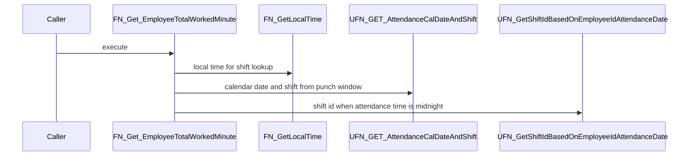
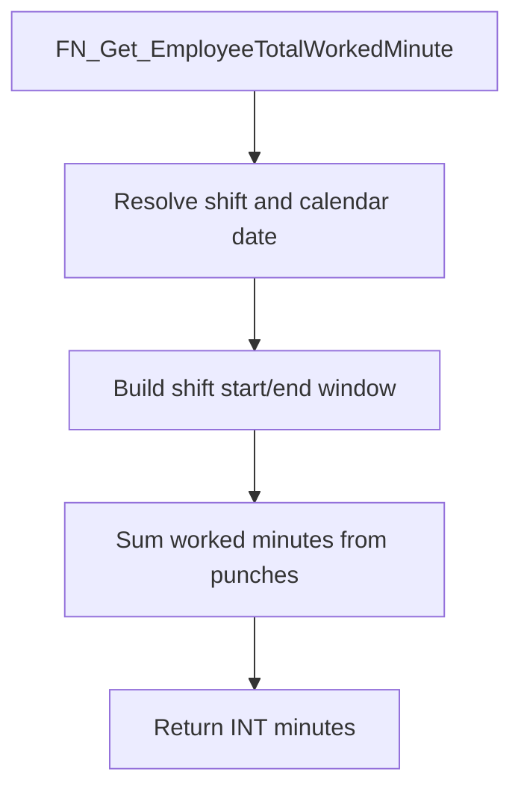

# FN_Get_EmployeeTotalWorkedMinute

## What it does

Returns total worked minutes for one employee on one attendance date (including night-shift and undefined-shift handling). Used by `SP_LeaveAttendance_DashBoard` when building swipe / attendance trend cards.

## Parameters

| Name | Direction | What it is for |
|---|---|---|
| `@AttendanceDate` | in | Attendance calendar date (or date-time) to evaluate |
| `@EmployeeId` | in | Employee whose punches and shift apply |

Returns `INT` minutes.

## Call sequence

## Callers

| Object | Kind | Page |
|---|---|---|
| `SP_LeaveAttendance_DashBoard` | procedure | [SP_LeaveAttendance_DashBoard](/docs/database/hrms/SP_LeaveAttendance_DashBoard) |

## Nested

| Object | Kind | When | Page |
|---|---|---|---|
| `FN_GetLocalTime` | function | resolve employer-local now | [FN_GetLocalTime](/docs/database/hrms/FN_GetLocalTime) |
| `UFN_GET_AttendanceCalDateAndShift` | function | map punch/datetime to attendance calendar day and shift | No page yet |
| `UFN_GetShiftIdBasedOnEmployeeIdAttendanceDate` | function | when `@AttendanceDate` has midnight time | No page yet |

## Steps

1. Read script `HRMS-DATABASE/HRMS/FUNCTIONS/FN_Get_EmployeeTotalWorkedMinute.sql`.
2. Resolve current local attendance calendar date/time via `UFN_GET_AttendanceCalDateAndShift` / `FN_GetLocalTime`.
3. Resolve `@lv_ShiftID` and attendance calendar date from `@AttendanceDate` (midnight vs timed path).
4. Load shift window from `TSHIFTMASTER` (early-in / late-out and next-day end).
5. Apply configurable attendance-duration rules and sum punch minutes into `@lv_TotalWorkedMinute`.
6. Return the integer minute total.

## Tables

| Table | Read or write |
|---|---|
| `dbo.TSHIFTMASTER` | read |
| `dbo.TAttendanceTransaction` (via helpers / body) | read |

## Flow

