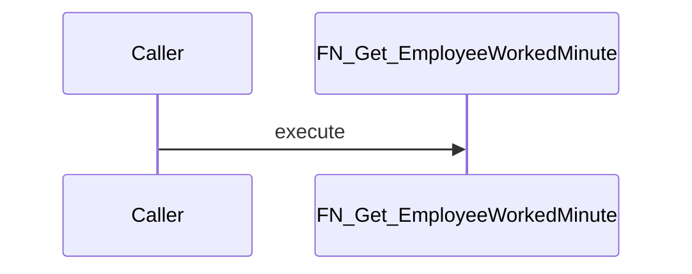
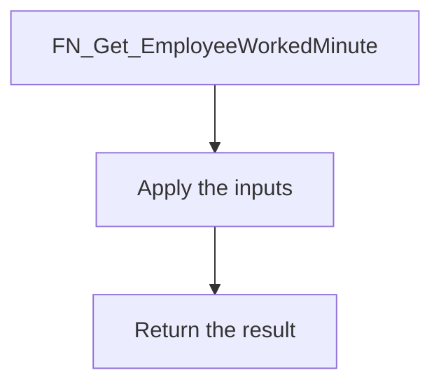

# FN_Get_EmployeeWorkedMinute

## What it does

Helper called by a Home dashboard procedure. It reads TShiftAttendanceConfig and returns that result to its caller.

## Parameters

| Name | Direction | What it is for |
|---|---|---|
| `@lEmployeeID` | in | Input used by this procedure (`INT`) |
| `@lAttendanceDate` | in | Input used by this procedure (`DATETIME`) |

## Call sequence

## Callers

| Object | Kind | Page |
|---|---|---|
| `SP_DB_EmployeeAttendanceDetails` | procedure | [SP_DB_EmployeeAttendanceDetails](/docs/database/hrms/SP_DB_EmployeeAttendanceDetails) |
| `SP_DB_EmployeeAttendanceDetails_HT` | procedure | No page yet |
| `SP_DB_EmployeeAttendanceFromEmailDetails` | procedure | No page yet |
| `SP_DB_EmployeeDayWiseAttendanceDetails` | procedure | No page yet |
| `SP_GetAttendance` | procedure | No page yet |
| `SP_GetTeamAttendanceDetailsNew` | procedure | [SP_GetTeamAttendanceDetailsNew](/docs/database/hrms/SP_GetTeamAttendanceDetailsNew) |
| `SP_LA_ValidateHourlyARRequest` | procedure | No page yet |
| `Sp_TS_GetEmpProjectDetails` | procedure | No page yet |
| `Sp_TS_GetEmpTimeSeetAttendanceDetails` | procedure | No page yet |
| `USP_Employee_ActualWorkedLeaveHours` | procedure | No page yet |
| `USP_Get_Employees_ActualWorkedMinutesLeaves` | procedure | No page yet |
| `USP_GetEmployeeLeaveAttendanceDetails` | procedure | No page yet |

## Nested

This object does not execute another procedure or user-defined function.

## Steps

In `HRMS-DATABASE/HRMS/FUNCTIONS/FN_Get_EmployeeWorkedMinute.sql`:

1. Read `TShiftAttendanceConfig`.
2. Return the result set to the caller.

## Tables

| Table | Read or write |
|---|---|
| `TShiftAttendanceConfig` | read |

## Flow

