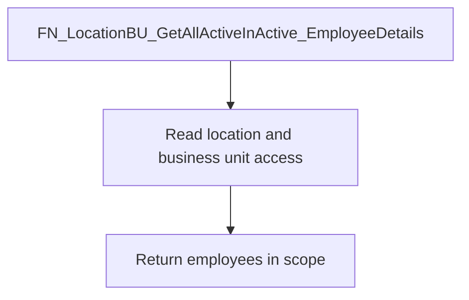

# FN_LocationBU_GetAllActiveInActive_EmployeeDetails

## What it does

Inline table function. Returns employee id and employer id for employees in the user's location and business-unit scope. A null or zero employer id uses the user's own employer plus employers from global access. Employee name is always null.

## Parameters

| Name | Direction | What it is for |
|---|---|---|
| `@EmployeeId` | in | User whose page mapping is read |
| `@EmployerId` | in | Employer filter. Null or 0 uses the access scope |

## Call sequence

Calls no other procedures or functions.

## Callers

Procedures and functions that call this object.

| Object | Kind | Page |
|---|---|---|
| `SP_BGV_GetVerificationDet` | procedure | No page yet |
| `Sp_CM_DirectIndirectReports` | procedure | No page yet |
| `Sp_CM_Mydetails_DirectIndirectReports` | procedure | No page yet |
| `Sp_CM_Mydetails_DirectIndirectReports_Count` | procedure | No page yet |
| `Sp_CM_Revamp_SearchEmployee` | procedure | No page yet |
| `SP_GenDocument_EmployeesList` | procedure | No page yet |
| `SP_GetAllActiveInActiveEmployeeList` | procedure | [SP_GetAllActiveInActiveEmployeeList](/docs/database/hrms/SP_GetAllActiveInActiveEmployeeList) |
| `SP_GetCompaRatioFilterOption` | procedure | No page yet |
| `SP_GetCompensationReport` | procedure | No page yet |
| `SP_GetSalaryBenchmarking` | procedure | No page yet |
| `SP_GetSalaryBenchmarkingEmployeeDetails` | procedure | No page yet |
| `SP_SEP_EmployeeBulkDeactivate` | procedure | No page yet |

## Nested

Calls no other procedures or functions.

## Steps

1. Read the user's role, global-access employer list, and location and business-unit ids from user and role page mapping (`FN_LocationBU_GetAllActiveInActive_EmployeeDetails.sql`).
2. When user location or business-unit ids are empty, use the role mapping.
3. Return employees in that employer set whose location and business unit match the lists, or every employee when a list is empty.

## Tables

| Table | Read or write |
|---|---|
| `dbo.TUserEmployee` | read |
| `dbo.TUsers` | read |
| `dbo.TUserPagesMapping` | read |
| `dbo.TRolePagesMapping` | read |
| `dbo.TEmployee` | read |
| `dbo.TEmployeeInfo` | read |
| `dbo.TLocation` | read |
| `dbo.TOrgHierarchyDetails` | read |

## Flow

