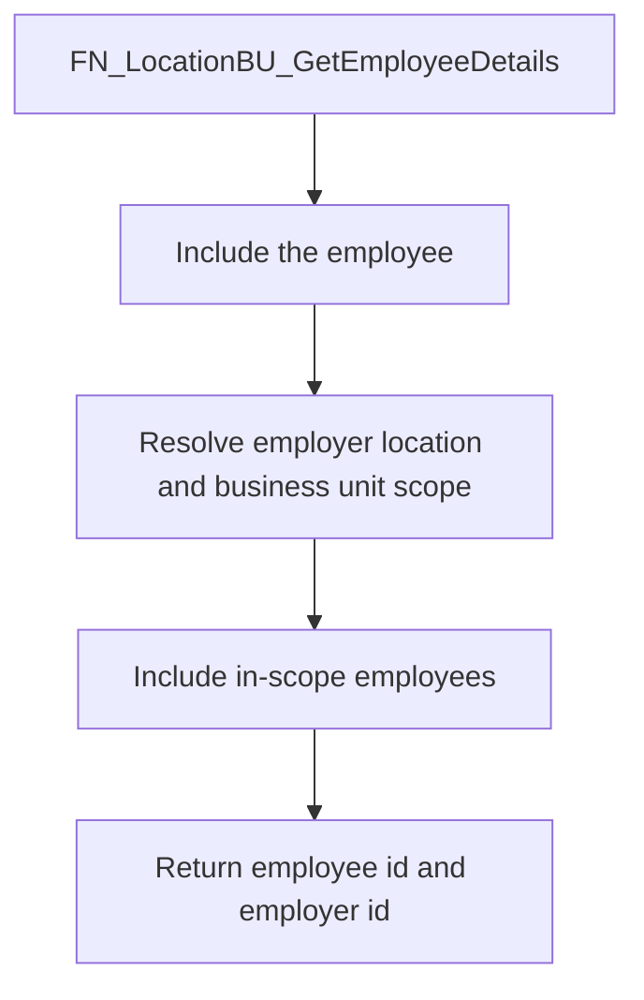

# FN_LocationBU_GetEmployeeDetails

## What it does

Inline table function. It returns the employee id and employer id of the given employee, plus other employees in the caller's employer scope whose location and business unit are allowed by the user or role page mapping. EmployeeName is returned as null. sp_GetChildOrganisations uses the employer id column to filter the parent combo.

## Parameters

| Name | Direction | What it is for |
|---|---|---|
| `@EmployeeId` | in | Employee whose access scope is applied |
| `@EmployerId` | in | When not null and not 0, only that employer is in scope. Otherwise the user's employer and global employer list are used |

## Call sequence

Calls no other procedures or functions.

## Callers

Procedures and functions that call this object.

| Object | Kind | Page |
|---|---|---|
| `Fn_DueAndOverdueDeactivations_Cnt` | function | No page yet |
| `SP_Admin_GetAllEmployeeDetails` | procedure | No page yet |
| `SP_AdminEMP_EmployeeSearch` | procedure | No page yet |
| `SP_AdminEMP_GetEmpListByOrg` | procedure | No page yet |
| `SP_AdminPMS_EmployeeGoalSettingSearch` | procedure | No page yet |
| `SP_AdminPMS_EmployeeSearch` | procedure | No page yet |
| `SP_AdminPMS_GetEmpByAppraisalCyclePermission` | procedure | No page yet |
| `Sp_AdminPMS_GetPendingAppList` | procedure | No page yet |
| `Sp_AdminPMS_GetPendingDesignationsForGoalSetting` | procedure | No page yet |
| `SP_BGV_GetAllActiveEmployee` | procedure | No page yet |
| `SP_CM_GetAllEmployeeDetails` | procedure | No page yet |
| `SP_CM_GetAllEmployeeListByOrg` | procedure | No page yet |
| `SP_CM_GetNotificationCnt_101` | procedure | No page yet |
| `SP_CM_GetNotificationCnt_82724` | procedure | No page yet |
| `SP_CM_GetNotificationCnt_bkp260626` | procedure | No page yet |
| `SP_CM_GetNotificationCnt_version4232025` | procedure | No page yet |
| `SP_CM_GetNotificationCntBKP03052025` | procedure | No page yet |
| `Sp_CMS_GetConfirmationDueList` | procedure | No page yet |
| `SP_CMS_GetConfirmationForApproval` | procedure | No page yet |
| `Sp_CMS_GetConfStatusEmployeeListForExtract` | procedure | No page yet |
| `Sp_CMS_GetEmployeeListForExtract` | procedure | No page yet |
| `SP_Creation_Admin_GetAllEmployeeDetails` | procedure | No page yet |
| `SP_DayWiseAttendance` | procedure | No page yet |
| `SP_EC_GetPendingPOBImportList` | procedure | No page yet |
| `Sp_employeeListByEmployerAndEmployee` | procedure | No page yet |
| `SP_ESS_CrossBUEmployeeAssignment` | procedure | No page yet |
| `SP_ESS_CrossBUEmployeeAssignmentUserDefined` | procedure | No page yet |
| `SP_ESS_GetBusinessCardRequestsForApproval` | procedure | No page yet |
| `Sp_Geo_GetEmpTrackLocationRports` | procedure | No page yet |
| `SP_GET_GetNewJoineeListAndCount` | procedure | [SP_GET_GetNewJoineeListAndCount](/docs/database/hrms/SP_GET_GetNewJoineeListAndCount) |
| `SP_GET_GetNewJoinneeEmpDetails` | procedure | No page yet |
| `SP_Get_MyTeamCard_InDirectReportees` | procedure | [SP_Get_MyTeamCard_InDirectReportees](/docs/database/hrms/SP_Get_MyTeamCard_InDirectReportees) |
| `SP_GET_TEmpSalary` | procedure | No page yet |
| `Sp_GetAllTrackingConfigurations` | procedure | No page yet |
| `sp_GetChildOrganisations` | procedure | [sp_GetChildOrganisations](/docs/database/hrms/sp_GetChildOrganisations) |
| `Sp_GetEmpAttendanceDetails` | procedure | No page yet |
| `Sp_GetEmpBirthDayAnniversaryDetails` | procedure | [Sp_GetEmpBirthDayAnniversaryDetails](/docs/database/hrms/Sp_GetEmpBirthDayAnniversaryDetails) |
| `Sp_GetEmpBirthDayAnniversaryDetails_DP` | procedure | No page yet |
| `SP_GetEmployeeListByOrgAndBU` | procedure | No page yet |
| `SP_GetEmployeeSalaryStructure` | procedure | No page yet |
| `SP_GetEmployeeSalaryStructure_History` | procedure | No page yet |
| `SP_GetEmployeeSalaryStructure_Pivot` | procedure | No page yet |
| `SP_GetHomePageDetails` | procedure | No page yet |
| `SP_GetHRHelpDeskNotification` | procedure | No page yet |
| `SP_GetHRHelpDeskRequestStatus` | procedure | No page yet |
| `SP_GetNewsANDEventDetails` | procedure | No page yet |
| `SP_GetTeamAttendanceDetailsNew` | procedure | [SP_GetTeamAttendanceDetailsNew](/docs/database/hrms/SP_GetTeamAttendanceDetailsNew) |
| `SP_GetTeamLeaveCard_DP` | procedure | No page yet |
| `SP_GETTEAMRESIGNATIONDETAILS` | procedure | No page yet |
| `SP_GETTEAMRESIGNATIONDETAILSBKP03052025` | procedure | No page yet |
| `SP_LA_GetAllNotificationToReassign` | procedure | No page yet |
| `SP_Mob_GetTempLocationDetails` | procedure | No page yet |
| `SP_PMS_GetAppraisalCycleDueList_UI` | procedure | No page yet |
| `Sp_PMS_GetAppraisalEmpByCycleID` | procedure | No page yet |
| `SP_PMS_GetAppraisalForApproval` | procedure | No page yet |
| `SP_PMS_GetBUListByAppPermission` | procedure | No page yet |
| `SP_PMS_GetConfirmationDueListForUI` | procedure | No page yet |
| `SP_PMS_GetEmployeeGoalSettingForApproval` | procedure | No page yet |
| `SP_PMS_GetNineBoxAssessmentList` | procedure | No page yet |
| `SP_PMS_GetNineBoxAssessmentMatrix` | procedure | No page yet |
| `SP_PMS_ParkPMSEmployeeAppraisalReportData` | procedure | No page yet |
| `SP_Report_TimeAndAttendance_LateInEarlyOutReport` | procedure | No page yet |
| `SP_RPT_EmpCheckInCheckOut` | procedure | No page yet |
| `SP_RPT_EmpCompetency` | procedure | No page yet |
| `SP_RPT_FPF_GetDisciplineRecords` | procedure | No page yet |
| `SP_RPT_GetAssetMappingDetails` | procedure | No page yet |
| `SP_RPT_GetCandidateCompensation` | procedure | No page yet |
| `SP_RPT_GetEmployeeCompensation` | procedure | No page yet |
| `SP_RPT_Leave_ByDate` | procedure | No page yet |
| `SP_RPT_vw_WorkLocationReport` | procedure | No page yet |
| `SP_SEP_EmployeeBulkDeactivate` | procedure | No page yet |
| `SP_SEP_GetAllEmpResignationDetails` | procedure | No page yet |
| `SP_SEP_GetAllPendingClearances` | procedure | No page yet |
| `SP_SEP_GetAllResignationByTemplateId` | procedure | No page yet |
| `SP_SEP_GetAllResignationDetails` | procedure | No page yet |
| `SP_SEP_GETALLRESIGNATIONDETAILSFILTER` | procedure | No page yet |
| `SP_SEP_GETALLRESIGNATIONDETAILSFILTERBKP03052025` | procedure | No page yet |
| `SP_SEP_GetAllSubmittedResignations` | procedure | No page yet |
| `SP_SEP_GetClearancesGroupedByClearanceCategory` | procedure | No page yet |
| `SP_SEP_GetDeactivationChecklist` | procedure | No page yet |
| `SP_SEP_GetEmpActForApproval` | procedure | No page yet |
| `SP_SEP_GetEmployeeResignationDetails` | procedure | No page yet |
| `SP_SEP_GetReInitiatedEmpActForApproval` | procedure | No page yet |
| `SP_SEP_GetResignationPullbackRequests` | procedure | No page yet |
| `SP_SEP_PendingDeactivations` | procedure | No page yet |
| `Sp_UserAccessRights_Rpt` | procedure | No page yet |
| `sp_vw_AttendanceRegularizationSummaryReports` | procedure | No page yet |
| `SP_vw_LeaveLedgerReport` | procedure | No page yet |
| `SP_vw_LeaveSummaryReports` | procedure | No page yet |
| `SP_vw_WorkFromHomeSummaryReports` | procedure | No page yet |
| `USP_AssetDisplaySettings_ListEmployees` | procedure | No page yet |
| `USP_AttendanceOverTime_Notification_List` | procedure | No page yet |
| `USP_ClaimOT_List` | procedure | No page yet |
| `USP_ClaimOT_Summary_Report` | procedure | No page yet |
| `USP_CM_FilterMasterData` | procedure | No page yet |
| `USP_DirectIndirectReportee` | procedure | No page yet |
| `USP_Employee_GetFilteredList` | procedure | No page yet |
| `USP_EmployeeFullInfoReports` | procedure | No page yet |
| `USP_EmployeeListBySiblingEmployers` | procedure | No page yet |
| `USP_EmployeeOrgScope_ListEmployees` | procedure | No page yet |
| `USP_FNF_Deactivated_Employee_List` | procedure | No page yet |
| `USP_FNF_Employee_Command` | procedure | No page yet |
| `USP_FNF_Employee_List` | procedure | No page yet |
| `USP_FNF_Payment_Employee_List` | procedure | No page yet |
| `USP_GeoTrackingDistanceReport` | procedure | No page yet |
| `USP_Get_EmployeeList` | procedure | No page yet |
| `USP_GetAttendanceForPayroll` | procedure | No page yet |
| `USP_GetEmployeeReporteeRelation` | procedure | No page yet |
| `USp_GetEmployeeReports` | procedure | No page yet |
| `USP_GetPendingTerminationDetail` | procedure | No page yet |
| `USP_GetSeparationPage_ForMe_Count` | procedure | No page yet |
| `USP_GetTerminationRecommendations` | procedure | No page yet |
| `USP_LA_Approved_Notification_List` | procedure | No page yet |
| `USP_LA_EmployeeAttendanceModeOverview` | procedure | No page yet |
| `USP_LA_EmployeeAttendanceModeOverview_GlobalFilter` | procedure | No page yet |
| `USP_LA_EmployeeAttendanceOverview` | procedure | No page yet |
| `USP_LA_EmployeeAttendanceOverview_GlobalFilter` | procedure | No page yet |
| `USP_LA_GetLeaveRequestDetails_By_Manager` | procedure | No page yet |
| `USP_LeaveRequest_Notification_ModalView` | procedure | No page yet |
| `USP_OT_GetScopedEmployees` | procedure | No page yet |
| `USP_OT_Notification_Deviation_ApprovedAll_List` | procedure | No page yet |
| `USP_OT_OTRequest_MyTeamsOT` | procedure | No page yet |
| `USP_OT_OTRequest_PreApproval_Report` | procedure | No page yet |
| `USP_OT_PreApproved_DayWise_Report` | procedure | No page yet |
| `USP_Report_Admin_AuditLogHistory` | procedure | No page yet |
| `USP_Report_Admin_DeletedPersonalInfoAuditLog` | procedure | No page yet |
| `USP_Report_Admin_EmployeeSearchPurpose` | procedure | No page yet |
| `USP_Report_BGV_PostEmployment` | procedure | No page yet |
| `USP_Report_Confirmation_ConfirmationStatus` | procedure | No page yet |
| `USP_Report_Custom_WorkFlowGroup` | procedure | No page yet |
| `USP_Report_EmployeeInfo_BenefitVouchers` | procedure | No page yet |
| `USP_Report_EmployeeInfo_EducationCertification` | procedure | No page yet |
| `USP_Report_EmployeeInfo_FamilyDetails` | procedure | No page yet |
| `USP_Report_EmployeeInfo_PassportVisaInfo` | procedure | No page yet |
| `USP_Report_EmployeeInfo_PolicyDocuments` | procedure | No page yet |
| `USP_Report_EmployeeInfo_StatutoryInfo` | procedure | No page yet |
| `USP_Report_ESS_HelpDesk` | procedure | No page yet |
| `USP_Report_Leave_GetAccessibleEmployees` | procedure | No page yet |
| `USP_Report_Separation_Separations` | procedure | No page yet |
| `USP_Report_TimeAttendance_DayWiseAttendance` | procedure | No page yet |
| `Usp_SeparationClearanceReport` | procedure | No page yet |
| `USP_TerminationClearanceReport` | procedure | No page yet |
| `USP_TM_GetEmployeeName` | procedure | No page yet |
| `USP_vw_AssignedEmployeeReport` | procedure | No page yet |

## Nested

Calls no other procedures or functions.

## Steps

1. Return the employee row for @EmployeeId.

2. Read the user's employer, global-access employer list, and location and business-unit lists from TUserEmployee, TUsers, TUserPagesMapping, and TRolePagesMapping. User page mappings win when they are non-blank, otherwise the role mapping is used.

3. When @EmployerId is null or 0, expand the employer scope to the user's employer and the global list. Otherwise use @EmployerId.

4. Return other employees on those employers, active or inactive, whose TEmployeeInfo location and business unit pass the CHARINDEX checks when those lists are restricted.

## Tables

| Table | Read or write |
|---|---|
| `TEmployee` | read |
| `TUserEmployee` | read |
| `TUsers` | read |
| `TUserPagesMapping` | read |
| `TRolePagesMapping` | read |
| `TEmployeeInfo` | read |
| `TLocation` | read |
| `TOrgHierarchyDetails` | read |

## Flow

