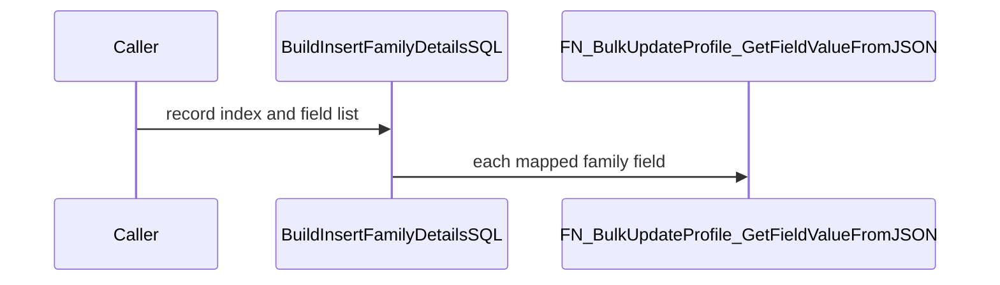
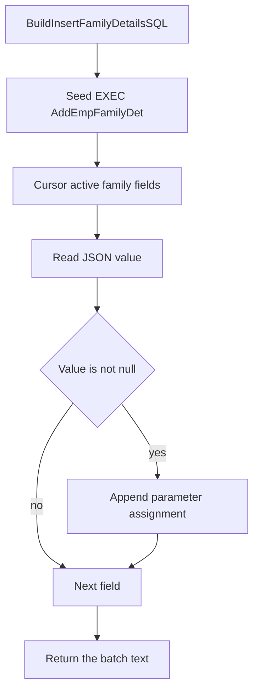

# FN_Mydetails_Enhanced_BuildInsertFamilyDetailsSQL

## What it does

Returns one `NVARCHAR` batch that declares local family parameters and executes `SP_Mydetails_Enhanced_AddEmpFamilyDet`. It only appends a parameter assignment when the JSON value for that display text is not null. Empty optional values become null before that check. The caller runs the returned text with `sp_executesql`.

## Parameters

| Name | Direction | What it is for |
|---|---|---|
| `@RecordIndex` | in | JSON array index passed to the field reader |
| `@EmployeeID` | in | Employee id embedded in the generated `EXEC` |
| `@FieldList` | in | Comma-separated display texts that may be included |
| `@EmployeeData` | in | JSON payload the field reader scans |
| `@IsOverride` | in | When 0, a blank optional value is stored as null |
| `@UpdatedBy` | in | Embedded as `@CreatedBy` on the generated `EXEC` |
| `@CountryID` | in | Country filter on `TEmployeeDetail_Fields` |
| `@SectionID` | in | Section filter on `TEmployeeDetail_Fields` |
| `@EmployerID` | in | Employer filter on `TEmployeeDetail_Fields` |

## Call sequence

The returned batch names `SP_Mydetails_Enhanced_AddEmpFamilyDet`. This function does not execute that procedure.

## Steps

1. Start the batch with `Exec SP_Mydetails_Enhanced_AddEmpFamilyDet` and the fixed family parameters (`FUNCTIONS/FN_Mydetails_Enhanced_BuildInsertFamilyDetailsSQL.sql`).
2. Map parameter names to display texts such as Relationship, Name, Date of Birth, Dependent, Address, Minor, and Unique Identification Number.
3. Cursor the active system or country fields for the employer, country, and section whose display text is in `@FieldList`, excluding `EmployeeFamilyDetailID`.
4. Read each value with `FN_BulkUpdateProfile_GetFieldValueFromJSON`.
5. When the value is not null, drop the placeholder assignment and append `@Parameter = 'value'`.
6. Trim the trailing comma, prepend the local variable declarations, and return the batch.

## Tables

| Table | Read or write |
|---|---|
| `dbo.TEmployeeDetail_Fields` | read |

## Procedures and functions it calls

| Object | Kind | When | Page |
|---|---|---|---|
| `FN_BulkUpdateProfile_GetFieldValueFromJSON` | function | each mapped field in the cursor | [FN_BulkUpdateProfile_GetFieldValueFromJSON](/docs/database/hrms/FN_BulkUpdateProfile_GetFieldValueFromJSON) |

## Unresolved calls

The returned string contains `Exec SP_Mydetails_Enhanced_AddEmpFamilyDet`. [SP_Mydetails_Enhanced_AddEmpFamilyDet](/docs/database/hrms/SP_Mydetails_Enhanced_AddEmpFamilyDet) runs only when the caller executes that string.

## Flow

