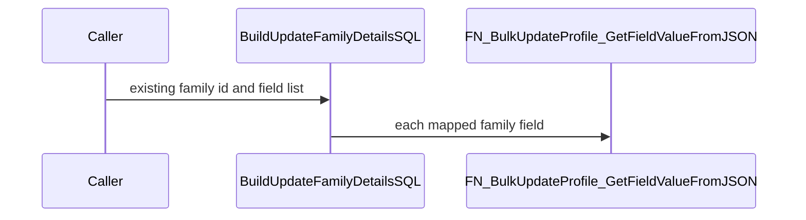
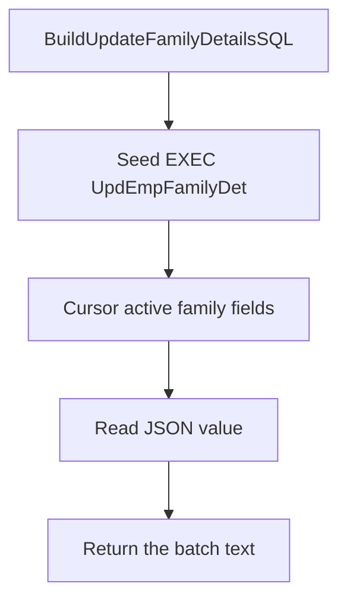

# FN_Mydetails_Enhanced_BuildUpdateFamilyDetailsSQL

## What it does

Returns one `NVARCHAR` batch that declares local family parameters and executes `SP_Mydetails_Enhanced_UpdEmpFamilyDet` for an existing `EmployeeFamilyDetailID`. It fills parameter assignments from the JSON the same way the insert builder does. The caller runs the returned text with `sp_executesql`. This function is the Update branch, not the Add branch.

## Parameters

| Name | Direction | What it is for |
|---|---|---|
| `@RecordIndex` | in | JSON array index passed to the field reader |
| `@EmployeeID` | in | Employee id embedded in the generated `EXEC` |
| `@FieldList` | in | Comma-separated display texts that may be included |
| `@EmployeeData` | in | JSON payload the field reader scans |
| `@IsOverride` | in | When 0, a blank optional value is stored as null |
| `@UpdatedBy` | in | Embedded as `@UpdatedBy` on the generated `EXEC` |
| `@CountryID` | in | Country filter on `TEmployeeDetail_Fields` |
| `@SectionID` | in | Section filter on `TEmployeeDetail_Fields` |
| `@EmployerID` | in | Employer filter on `TEmployeeDetail_Fields` |
| `@EmployeeFamilyDetailID` | in | Existing family id embedded in the generated `EXEC` |

## Call sequence

The returned batch names `SP_Mydetails_Enhanced_UpdEmpFamilyDet`. This function does not execute that procedure.

## Callers

| Object | Kind | Page |
|---|---|---|
| `SP_Mydetails_Enhanced_ProcessEmployeeFamilyDetails` | procedure | [SP_Mydetails_Enhanced_ProcessEmployeeFamilyDetails](/docs/database/hrms/SP_Mydetails_Enhanced_ProcessEmployeeFamilyDetails) |

## Nested

| Object | Kind | When | Page |
|---|---|---|---|
| `FN_BulkUpdateProfile_GetFieldValueFromJSON` | function | each mapped field in the cursor | [FN_BulkUpdateProfile_GetFieldValueFromJSON](/docs/database/hrms/FN_BulkUpdateProfile_GetFieldValueFromJSON) |

## Steps

1. Start the batch with `Exec SP_Mydetails_Enhanced_UpdEmpFamilyDet` and the existing family id (`FUNCTIONS/FN_Mydetails_Enhanced_BuildUpdateFamilyDetailsSQL.sql`).
2. Cursor active system or country fields for the employer, country, and section.
3. Read each JSON value with `FN_BulkUpdateProfile_GetFieldValueFromJSON` and append non-null assignments.
4. Trim the trailing comma, prepend local declarations, and return the batch.

## Tables

| Table | Read or write |
|---|---|
| `dbo.TEmployeeDetail_Fields` | read |

## Unresolved calls

The returned string contains `Exec SP_Mydetails_Enhanced_UpdEmpFamilyDet`. [SP_Mydetails_Enhanced_UpdEmpFamilyDet](/docs/database/hrms/SP_Mydetails_Enhanced_UpdEmpFamilyDet) runs only when the caller executes that string.

## Flow

