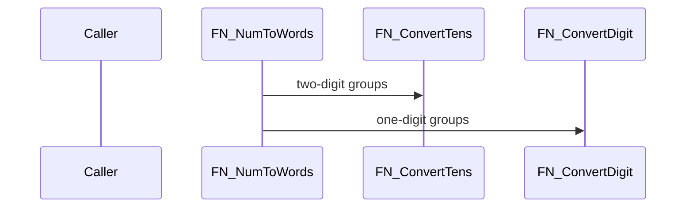
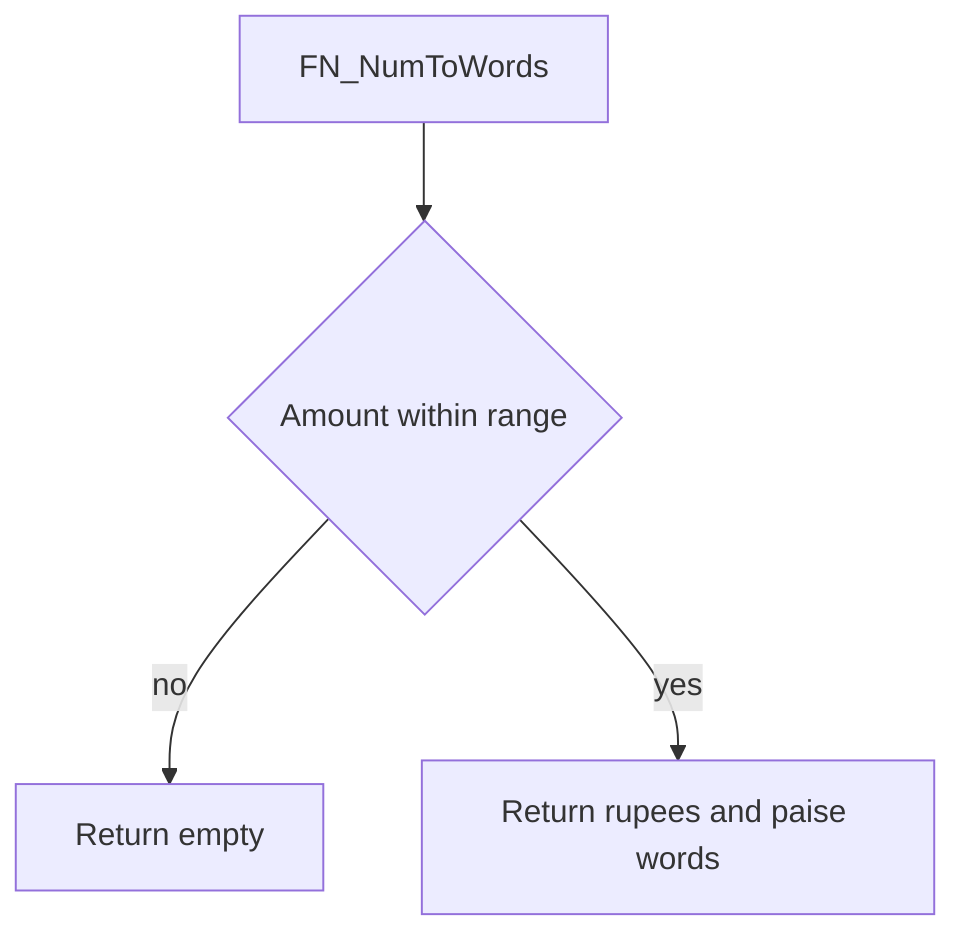

# FN_NumToWords

## What it does

Turns a decimal amount into rupees and paise words. Amounts above 99999999.99 return an empty string.

## Parameters

| Name | Direction | What it is for |
|---|---|---|
| `@decNumber` | in | Amount |

## Call sequence

## Callers

Procedures and functions that call this object.

| Object | Kind | Page |
|---|---|---|
| `SP_GetEmployeeLetterDetails` | procedure | [SP_GetEmployeeLetterDetails](/docs/database/hrms/SP_GetEmployeeLetterDetails) |
| `USP_GetEmailplaceHolder` | procedure | No page yet |
| `usp_vw_RRSCandidateOfferLetter` | procedure | No page yet |
| `usp_vw_RRSCandidateOfferLetterEmail` | procedure | No page yet |

## Nested

| Object | Kind | When | Page |
|---|---|---|---|
| `FN_ConvertTens` | function | two-digit groups | No page yet |
| `FN_ConvertDigit` | function | one-digit groups | No page yet |

## Steps

1. Return an empty string when the amount is above 99999999.99 (`FN_NumToWords.sql`).
2. Split rupees and paise and convert each digit group with `FN_ConvertDigit` and `FN_ConvertTens`.

## Tables

No table is read or written.

## Flow

