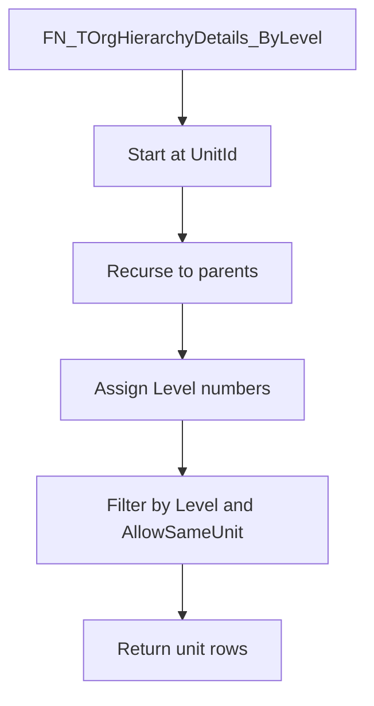

# FN_TOrgHierarchyDetails_ByLevel

## What it does

Inline table-valued function that walks `TOrgHierarchyDetails` upward from a unit to its parents and returns rows filtered by hierarchy level. Used by Assessment Report’s employee list (when the function object exists) to resolve the Department column as the level-1 unit name for an employee’s business unit.

## Parameters

| Name | Direction | What it is for |
|---|---|---|
| `@EmployerId` | in | Employer of the org hierarchy |
| `@UnitId` | in | Starting unit id |
| `@Level` | in | `-2` all from above level 1, `-1` all levels, `0` same unit, `>= 1` that level (default `1`) |
| `@AllowSameUnit` | in | When `0`, exclude the starting `@UnitId` (default `1`) |

## Call sequence

Calls no other procedures or functions.

## Callers

Procedures and functions that call this object.

| Object | Kind | Page |
|---|---|---|
| `Sp_PMS_GetAppraisalEmpByCycleID` | procedure | [Sp_PMS_GetAppraisalEmpByCycleID](/docs/database/hrms/Sp_PMS_GetAppraisalEmpByCycleID) |
| `SP_BulkProfile_ErrorValidation` | procedure | No page yet |
| `SP_BulkProfile_UpdateEmployeeOfficialInformation` | procedure | No page yet |
| `SP_Bulk_Create_Activate_Employee` | procedure | No page yet |
| `SP_EC_UpdateEmployeeOfficialInformation` | procedure | No page yet |
| `SP_EC_UpdateEmployeeOfficialInformation_240624` | procedure | No page yet |
| `SP_Mydetails_Enhanced_ErrorValidation` | procedure | No page yet |
| `SP_Mydetails_Enhanced_UpdateEmployeeOfficialInformation` | procedure | No page yet |

## Nested

Calls no other procedures or functions.

## Steps

1. Anchor on the `TOrgHierarchyDetails` row for `@EmployerId` and `@UnitId`.

2. Recurse to parent units while `ParentUnitId > 0`.

3. Number levels with `row_number` ordered by employer, parent, unit.

4. Filter by `@Level` and `@AllowSameUnit` rules; return `Level`, `EmployerId`, `ParentUnitId`, `UnitId`, `UnitName`.

## Tables

| Table | Read or write |
|---|---|
| `TOrgHierarchyDetails` | read |

## Flow

