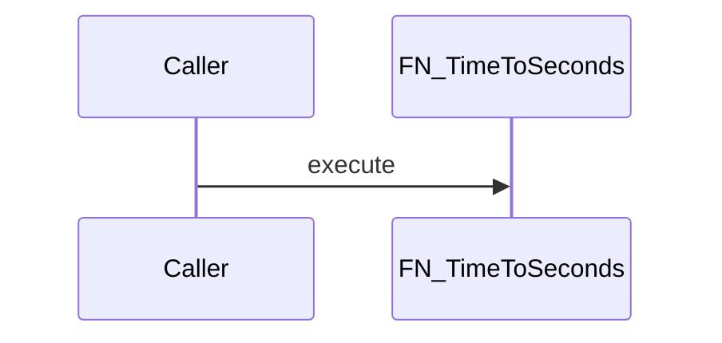
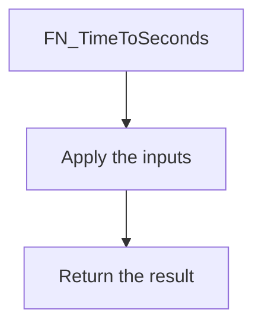

# FN_TimeToSeconds

## What it does

Helper called by a Home dashboard procedure. It reads its inputs and returns that result to its caller.

## Parameters

This object has no parameters.

## Call sequence

## Callers

| Object | Kind | Page |
|---|---|---|
| `Sp_TR_GetAdvanceReportDetails` | procedure | No page yet |
| `Sp_TR_GetAdvanceReportDetails_30Jan2023` | procedure | No page yet |
| `sp_tr_getPmsTniReport` | procedure | No page yet |
| `Sp_TR_GetTeamTrainingsReport` | procedure | No page yet |
| `Sp_TR_GetTrainingEvaluationsDetails` | procedure | No page yet |
| `sp_tr_pms_tni_details` | procedure | No page yet |
| `TFN_Training_Attendance_Online` | function | No page yet |
| `USP_Dashboard_Report` | procedure | No page yet |
| `USP_Resource_Tracker_Report` | procedure | No page yet |
| `USP_Training_Calender_Report` | procedure | No page yet |
| `USP_Upcoming_Trainings_Report` | procedure | [USP_Upcoming_Trainings_Report](/docs/database/hrms-training/USP_Upcoming_Trainings_Report) |

## Nested

This object does not execute another procedure or user-defined function.

## Steps

In `HRMS-DATABASE/HRMS/FUNCTIONS/FN_TimeToSeconds.sql`:

1. Return the result set to the caller.

## Tables

No permanent table is read or written. The result comes from parameters, functions, or table variables.

## Flow

