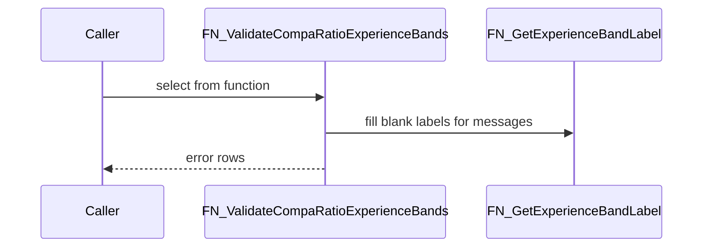
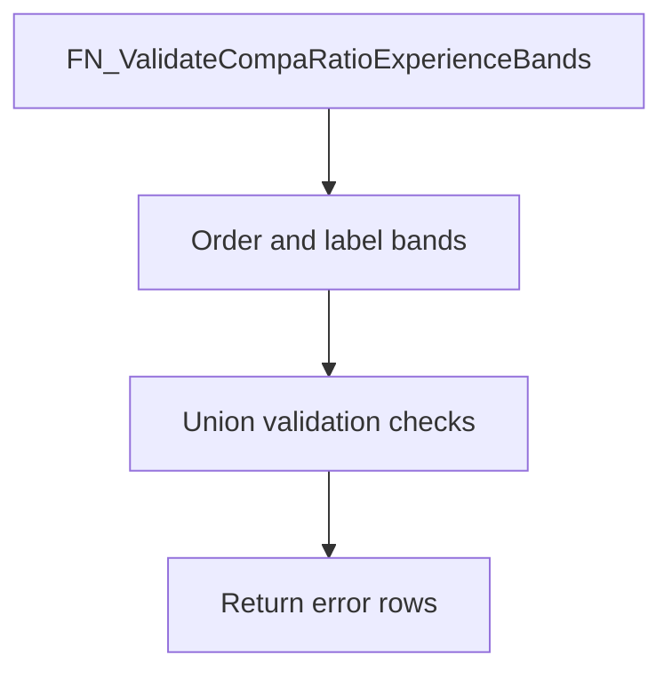

# FN_ValidateCompaRatioExperienceBands

## What it does

Inline table-valued function that validates a `UDT_CompensationExperienceBand` set. Emits typed error rows for empty set, negative years, first band not starting at 0, Max less than Min, gaps, overlaps, and (when `@IsSaveAttempt = 1`) missing Min/Max on non-open-ended bands. Gap rows may include an AutoFixMin suggestion.

## Parameters

| Name | Direction | What it is for |
|---|---|---|
| `@Bands` | in | Proposed band TVP |
| `@IsSaveAttempt` | in | When 1, also require Min/Max on non-last bands |

## Call sequence

## Callers

Procedures and functions that call this object.

| Object | Kind | Page |
|---|---|---|
| `SP_ValidateCompaRatioExperienceBands` | procedure | [SP_ValidateCompaRatioExperienceBands](/docs/database/hrms/SP_ValidateCompaRatioExperienceBands) |
| `SP_InsertUpdateCompaRatioConfig` | procedure | [SP_InsertUpdateCompaRatioConfig](/docs/database/hrms/SP_InsertUpdateCompaRatioConfig) |

## Nested

| Object | Kind | When | Page |
|---|---|---|---|
| `FN_GetExperienceBandLabel` | function | blank BandLabel in error text | [FN_GetExperienceBandLabel](/docs/database/hrms/FN_GetExperienceBandLabel) |

## Steps

1. Number bands by SortOrder and mark the last row as open-ended (`FUNCTIONS/FN_ValidateCompaRatioExperienceBands.sql`).

2. Resolve display labels via `FN_GetExperienceBandLabel` when BandLabel is blank.

3. Union error predicates (NO_BANDS, NEGATIVE, FIRST_NOT_ZERO, MIN/MAX_REQUIRED when saving, MAX_LT_MIN, GAP, OVERLAP).

## Tables

| Table | Read or write |
|---|---|
| _(none)_ | TVP input only |

## Flow

